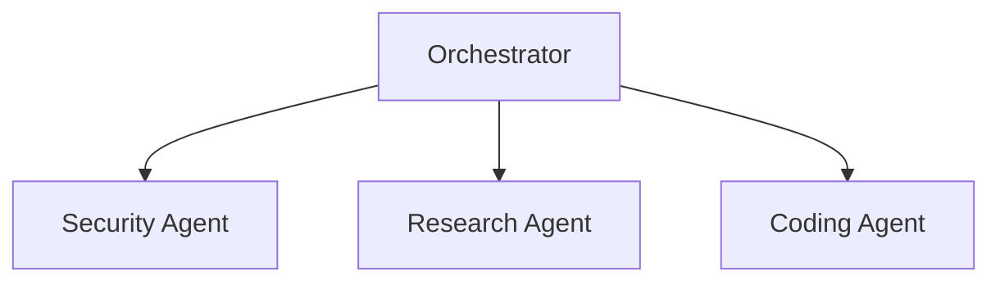
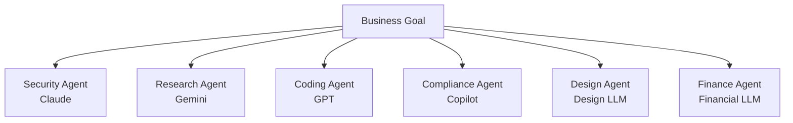
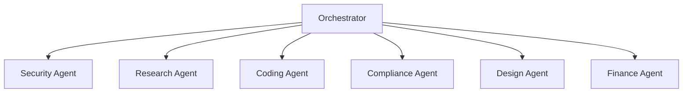
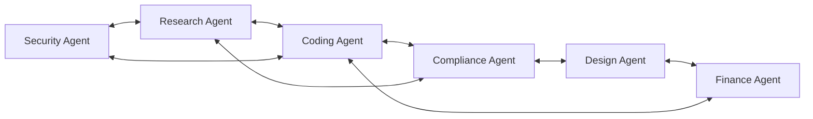
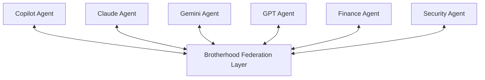
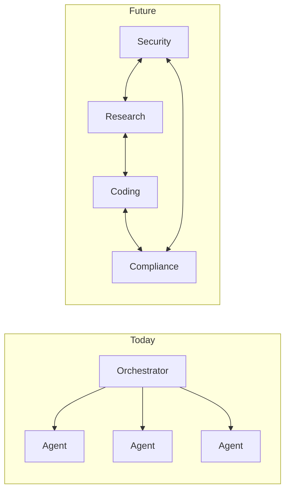
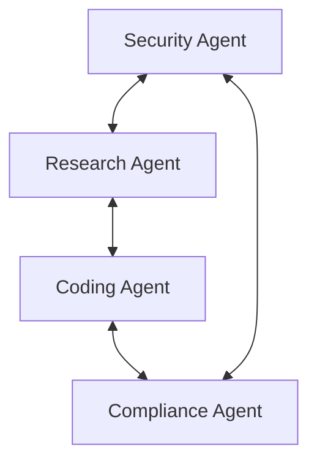

Я хочу запустить проект по созданию моста или соединения между корпоративных чат клиентами. Если одна компания использует ms teams а другая slack, я хочу создать сервис, прозрачный для пользователя и полностью защищённый корпоративно. Найди мне примеры и в чём есть трудности. Я уверен - это очень сложный дрмен. Я так же уверен, что компании будут платить деньги за интеграцию. Модель бизнеса обсуждаем. Составь направления исследования и основные трудности.


Идея хорошая. Более того, рынок уже доказал, что за такое платят. Но я бы сразу сказал: это не интеграция, а Infrastructure/Security продукт уровня Enterprise.

Условно:

"Пользователь Teams пишет сообщение. Пользователь Slack получает его как будто оно было отправлено нативно в Slack. И наоборот. Без переключения приложений. С сохранением корпоративной безопасности, журналирования, retention, eDiscovery и DLP."

Именно в этом и состоит сложность.

Кто уже пытался решить эту проблему

Существуют продукты:

Mio
NextPlane
Conclude
SyncRivo
несколько более мелких игроков

Mio позиционирует себя как платформу interoperability между Teams, Slack, Google Chat и другими корпоративными платформами. Они синхронизируют сообщения, директории пользователей и файлы через API обеих систем.

Google даже официально объявлял поддержку interoperability Google Chat ↔ Teams ↔ Slack через Mio.

Это хороший знак:

✅ рынок существует

✅ компании готовы платить

✅ проблема реальная

Почему проблема до сих пор не решена нативно

Потому что Microsoft и Slack не заинтересованы.

Для Microsoft идеальный мир:

все работают в Teams

Для Slack:

все работают в Slack

Поэтому прямой федерации Teams ↔ Slack нет.

Teams умеет федерацию только внутри экосистем Microsoft через External Access, Guest Access и Teams Connect.

Главный вопрос

На самом деле вы продаёте не "чат-мост".

Вы продаёте:

Secure Enterprise Messaging Federation

Похоже на SMTP для корпоративных чатов.

Основные направления исследования
1. Messaging Layer

Самый очевидный уровень.

Нужно понимать:

канал
thread
reply
emoji reaction
edit
delete
mention

Например:

Slack:

channel
thread
emoji
app user


Teams:

channel
conversation
reply
adaptive card


Соответствие далеко не 1:1.

2. Identity Federation

Самая болезненная тема.

У пользователя есть:

john@contoso.com


в Teams.

В Slack он может быть:

john.smith


или вообще другой аккаунт.

Нужно строить:

Identity Mapping


иначе @mention перестанут работать.

Mio отдельно рекламирует именно directory synchronization как одну из ключевых функций.

3. Files

Очень большая проблема.

Teams:

SharePoint
OneDrive

Slack:

собственное файловое хранилище

Нужно решить:

кто хранит файл
кто имеет доступ
какой URL отдавать
4. Compliance

Это может стать главным selling point.

Большие компании покупают не чат.

Они покупают:

eDiscovery
Legal Hold
Audit
Regulatory Compliance

Slack имеет Discovery API именно для юридического и комплаенс-экспорта данных.

Teams имеет Export API и Graph API для экспорта сообщений, включая удалённые сообщения, архивирование и комплаенс-сценарии.

5. Security

Самый важный блок.

Enterprise заказчик первым делом спросит:

Где лежат наши сообщения?

Если ответ:

На серверах стартапа


многие откажутся.

Поэтому нужно проектировать либо:

Model A

Store-and-forward

Teams -> ваш сервер -> Slack


простая разработка

хуже безопасность

Model B

Transient relay

Teams -> relay -> Slack


сообщение не хранится

хранится только routing metadata

Это уже enterprise-grade архитектура.

6. Multi-Tenant Architecture

Допустим один клиент:

Pfizer


Другой:

Goldman Sachs


Нельзя смешать ничего:

ключи
токены
данные
журналы

Потребуется строгая изоляция tenant.

Самые неприятные технические проблемы
Проблема №1

Редактирование сообщений.

Slack:

edit message


↓

Teams должен обновить существующее сообщение.

Но не все сценарии поддерживаются одинаково.

Проблема №2

Удаление сообщений

Если пользователь удалил сообщение в Teams:

Delete


Нужно ли удалить его в Slack?

А если retention policy запрещает удаление?

Возникают юридические вопросы.

Проблема №3

Threads

Очень много мостов ломаются именно здесь.

Slack и Teams моделируют обсуждения по-разному.

Проблема №4

Rate Limits

Обе платформы ограничивают API.

При высокой нагрузке:

100k users
2M messages/day


появятся очереди.

Где я вижу реальную бизнес-возможность

Не для SMB.

Для Enterprise.

Например:

банки
страховые
фарма
оборонка
консалтинг

Типовая ситуация:

Компания А = Teams
Компания Б = Slack


Они ведут совместный проект.

Никто не хочет:

мигрировать
создавать guest accounts
использовать второй клиент

Тогда появляется ваш продукт.

Я бы разделил исследование на 3 этапа
Этап 1. Feasibility

Проверить:

Teams API
Slack API
message sync
user mapping

Сделать POC за 2-4 недели.

Этап 2. Enterprise Security

Изучить:

SOC2
ISO 27001
FedRAMP
Microsoft Purview
Slack Discovery API

Это будет критично для продаж.

Этап 3. Product Strategy

Я бы рассматривал не просто:

Teams <-> Slack


а платформу:

Teams
Slack
Google Chat
Webex
Zoom Team Chat
Mattermost
Rocket.Chat


То есть стать "SMTP для корпоративных мессенджеров".

На мой взгляд, именно это направление может стать многомиллионным продуктом, потому что проблема особенно обостряется после слияний компаний (M&A), когда разные подразделения годами остаются на разных платформах, а миграция стоит миллионы долларов. Именно поэтому рынок interoperability вообще появился.

Если смотреть как инвестор, я бы оценивал этот проект не как "интеграцию Teams и Slack", а как Enterprise Communication Federation Platform. Это намного более крупная и интересная категория.

У них есть mcp?

Да, но тут есть интересный нюанс.

Slack — уже имеет официальный MCP

Slack официально предоставляет Slack MCP Server. Через него AI-агенты могут:

читать каналы и треды;
искать сообщения;
отправлять сообщения;
работать с файлами;
создавать каналы;
получать информацию о пользователях.

Slack даже опубликовал документацию и поддержку партнеров вроде Claude, ChatGPT, Cursor и других MCP-клиентов.

Microsoft — тоже движется в эту сторону

У Microsoft есть Microsoft MCP Server for Enterprise (через Microsoft Graph), который позволяет агенту обращаться к данным Microsoft 365 и Entra ID через MCP. Сейчас это отдельный продукт уровня Enterprise и Graph-интеграций.

Также существует множество Graph MCP проектов и серверов вокруг Microsoft Graph.

Mio (компания-мост между Teams и Slack)

Я не нашёл признаков, что их основной продукт interoperability построен на MCP.

Наоборот, из описаний видно, что они используют:

Slack API;
Microsoft Graph API;
directory sync;
message relay;
собственный middleware layer между платформами.

То есть архитектура выглядит скорее так:

Slack API
      \
       \
      Mio Hub
       /
      /
Microsoft Graph


а не через MCP.

Для твоей идеи это важно

Я бы вообще рассматривал MCP как новую возможность.

Можно пойти двумя путями:

Вариант 1 — классический bridge
Teams <-> Your Service <-> Slack


Это делают существующие игроки.

Вариант 2 — AI Federation Layer
Teams
   \
    \
     Federation/MCP Platform
    /
   /
Slack
Google Chat
Webex
Zoom


Тогда твой сервис становится не просто мостом сообщений, а:

единым каталогом пользователей;
единым слоем безопасности;
MCP endpoint для AI-агентов.

То есть Copilot, Claude, OpenAI Agent могут видеть межкорпоративные коммуникации через один MCP интерфейс.

Это уже выглядит как продукт класса:

"Enterprise Communication Fabric"

и, честно говоря, значительно интереснее для инвесторов, чем ещё один Teams↔Slack bridge.

Я бы на твоём месте отдельно исследовал идею:"Federated Enterprise Messaging + MCP Gateway" — мне кажется тут может быть даже больше денег, чем в обычной синхронизации чатов.

Предложи архитектуру MCP-шлюза

Если бы я делал стартап с нуля сегодня, я бы не строил просто Teams↔Slack bridge.

Я бы строил Federated Messaging Gateway с MCP-интерфейсом.

Получается архитектура уровня "Twilio для корпоративных мессенджеров".

Высокоуровневая схема
                 ┌────────────────┐
                 │ Claude/Copilot │
                 │ ChatGPT Agent  │
                 └───────┬────────┘
                         │ MCP
                         ▼
               ┌────────────────────┐
               │ Federated MCP API  │
               └─────────┬──────────┘
                         │
           ┌─────────────┼─────────────┐
           │             │             │
           ▼             ▼             ▼

    ┌──────────┐  ┌──────────┐  ┌──────────┐
    │ Identity │  │ Routing  │  │ Security │
    │ Service  │  │ Engine   │  │ Engine   │
    └──────────┘  └──────────┘  └──────────┘

           │             │             │

           └─────────────┼─────────────┘
                         │
                         ▼

              ┌────────────────────┐
              │ Event Bus / Kafka  │
              └─────────┬──────────┘

        ┌───────────────┼───────────────┐
        │               │               │
        ▼               ▼               ▼

 ┌───────────┐   ┌───────────┐   ┌───────────┐
 │ Teams     │   │ Slack     │   │ Google    │
 │ Adapter   │   │ Adapter   │   │ Adapter   │
 └───────────┘   └───────────┘   └───────────┘

Основная идея

Все платформы становятся "адаптерами".

Никогда нельзя делать:

Teams -> Slack
Slack -> Teams
Teams -> Google
Slack -> Google


Потому что тогда получится:

N*(N-1)


интеграций.

Правильная модель:

Teams -> Federation Model
Slack -> Federation Model
Google -> Federation Model


То есть каждая система знает только:

Internal Model

Canonical Message Model

Самая важная сущность.

Например:

{
  "messageId": "msg-123",
  "tenantId": "tenant-a",
  "conversationId": "conv-55",
  "userId": "u-10",

  "body": "Hello",

  "attachments": [],

  "threadId": "thread-1",

  "mentions": [
    "u-22"
  ],

  "reactions": [
    {
      "emoji": "👍",
      "userId": "u-44"
    }
  ],

  "timestamp": "2026-10-31T12:00:00Z"
}

Identity Service

Самая сложная часть.

Хранит:

Teams User
Slack User
Google User


и строит федерацию.

Пример:

{
  "globalUserId": "usr-1",

  "accounts": [
    {
      "platform": "teams",
      "id": "abc123"
    },
    {
      "platform": "slack",
      "id": "u457"
    }
  ]
}

Routing Engine

Главный компонент.

Логика:

Message received
        ↓
Resolve tenant
        ↓
Resolve destination
        ↓
Apply policies
        ↓
Route into target platform


Пример:

Slack Channel A
      ↓
Partner B
      ↓
Teams Channel Q

Security Engine

На мой взгляд это половина продукта.

Проверяет:

DLP
Legal Hold
Classification
Retention
Encryption


До пересылки.

Пример политики:

if classification == "Confidential":
    block_external_delivery

Event Driven Architecture

Никаких прямых вызовов.

Плохо:

Teams API
   ↓
Slack API


Хорошо:

Teams API
   ↓
Kafka
   ↓
Routing
   ↓
Kafka
   ↓
Slack API


Это позволит переживать:

rate limits;
падения Slack;
падения Teams;
массовые рассылки.
MCP Gateway

Самое интересное место.

AI видит не Slack и не Teams.

Он видит:

search_messages()
send_message()
create_bridge()
get_tenant_users()
list_channels()


Пример MCP Tool

{
  "name": "send_message",
  "description": "Send federated message",

  "inputSchema": {
    "type": "object",

    "properties": {
      "channel": {
        "type": "string"
      },

      "message": {
        "type": "string"
      }
    }
  }
}

Enterprise AI Feature

Тут может быть киллер-фича.

"Покажи все обсуждения между Pfizer и Deloitte
за последние 30 дней"


AI вызывает:

search_messages()


и ищет сразу:

Teams
Slack
Google Chat

через единый индекс.

Compliance Store

Очень большой рынок.

Отдельный сервис:

Message Journal


Хранит:

message created
message edited
message deleted
reaction added
file uploaded


в неизменяемом журнале.

Многие банки купят продукт ради этого одного модуля.

Если бы я делал MVP

Я бы сделал всего 5 сервисов:

1. Teams Adapter
2. Slack Adapter
3. Routing Service
4. Identity Service
5. MCP Gateway


Без:

файлов;
голоса;
видеозвонков;
DLP.

И MVP выглядел бы так:

Teams Channel
     ↕
Routing Engine
     ↕
Slack Channel


Плюс MCP-инструменты:

search_messages
send_message
list_channels
create_bridge


Через 2–3 месяца можно показать работающий прототип инвестору.

А уже второй этап — превратить его в полноценный Enterprise Messaging Federation Platform, где MCP становится не дополнением, а основным интерфейсом для Copilot, ChatGPT, Claude и внутренних AI-агентов компании.


Canonical message model уже существует?

Короткий ответ: нет, общепринятого Canonical Message Model для enterprise-мессенджеров не существует.

Именно поэтому рынок interoperability до сих пор относительно пустой.

Есть несколько близких вещей, но ни одна не стала "HTTP для чатов".

Что существует сегодня
1. Microsoft Graph ChatMessage

Microsoft фактически имеет собственную каноническую модель сообщений внутри экосистемы M365:

chatMessage
 ├─ body
 ├─ attachments
 ├─ mentions
 ├─ reactions
 ├─ hostedContent
 └─ replies


Она используется для Teams и доступна через Graph API.

Но это модель Microsoft.

2. Slack Message Model

Slack имеет совершенно другую модель:

message
 ├─ text
 ├─ blocks
 ├─ thread_ts
 ├─ reactions
 ├─ files
 └─ metadata


через Web API и Events API.

3. Matrix Event Model

Это, пожалуй, самый близкий кандидат на "стандарт".

Matrix построен вокруг универсального события:

{
  "event_id": "...",
  "type": "m.room.message",
  "sender": "@user:server",
  "content": {
    "body": "Hello"
  }
}


Но Enterprise его почти не использует.

4. XMPP

Когда-то пытался решить эту проблему.

Идея была:

Federated Messaging


между разными системами.

Почти как SMTP для почты.

Но компании ушли в закрытые SaaS-платформы.

Самое интересное наблюдение

Если посмотреть на Mio, NextPlane и похожие продукты, они фактически вынуждены создавать свою внутреннюю модель.

То есть внутри любого такого продукта всегда есть нечто вроде:

Slack Adapter
        ↓

 Canonical Model

        ↓
Teams Adapter


иначе невозможно поддерживать:

Slack
Teams
Google Chat
Zoom Chat
Webex

одновременно.

Где может быть возможность

Если честно, я вижу тут потенциально отдельный продукт.

Не мост.

А открытый стандарт.

Например:

Open Federated Messaging Model (OFMM)


или

Enterprise Message Schema (EMS)


Что-то вроде:

{
  "id": "...",

  "tenant": "...",

  "conversation": "...",

  "sender": {
      "id": "...",
      "displayName": "..."
  },

  "body": {
      "text": "...",
      "html": "..."
  },

  "thread": "...",

  "attachments": [],

  "mentions": [],

  "reactions": [],

  "metadata": {},

  "compliance": {
      "classification": "confidential",
      "retentionPolicy": "7y"
  }
}

Более глубокая мысль

Если делать MCP Gateway, я бы вообще канонизировал не сообщения, а события.

Не:

Message


а:

Event


например:

{
  "eventType": "message.created"
}

{
  "eventType": "message.edited"
}

{
  "eventType": "message.deleted"
}

{
  "eventType": "reaction.added"
}

{
  "eventType": "member.joined"
}


Это уже очень похоже на архитектуру Kafka, Event Sourcing и современные интеграционные шины.

На самом деле, если копнуть глубже, то самая интересная идея в твоём проекте может оказаться не Teams↔Slack-мостом, а созданием универсальной модели корпоративного общения, поверх которой работают и мосты, и MCP, и AI-агенты. Именно такого стандарта на рынке сейчас фактически нет.

Спроектируй схему OFMM

Мне нравится мысль сделать OFMM не как модель сообщения, а как универсальную модель событий корпоративной коллаборации.

Если думать на 10 лет вперёд, OFMM должен покрывать:

Teams
Slack
Google Chat
Webex
Zoom Team Chat
Discord Enterprise
будущие AI-native платформы

Поэтому ядро должно быть максимально абстрактным.

OFMM v1
Базовые принципы
1. Event First

Все является событием.

Не:

Message


а:

Event

2. Immutable

Событие никогда не меняется.

Редактирование сообщения:

message.created
message.edited


Удаление:

message.deleted

3. Platform Agnostic

OFMM не знает что такое:

Slack
Teams
Google

Корневой объект
{
  "specVersion": "1.0",

  "eventId": "evt_123",

  "eventType": "message.created",

  "timestamp": "2026-11-01T10:00:00Z",

  "tenantId": "pfizer",

  "source": {
    "platform": "slack",
    "workspaceId": "ws_001"
  },

  "actor": {},

  "context": {},

  "payload": {}
}

Источник
{
  "platform": "slack",
  "tenant": "acme",
  "workspaceId": "W123"
}


или

{
  "platform": "teams",
  "tenant": "contoso",
  "teamId": "team-5"
}

Actor

Универсальный пользователь.

{
  "id": "usr_001",

  "externalId": "U12345",

  "displayName": "John Smith",

  "email": "john@company.com",

  "identityProvider": "entra"
}

Conversation Context
{
  "conversationId": "conv_001",

  "conversationType": "channel",

  "threadId": "thr_001",

  "participants": [
    "usr_001",
    "usr_002"
  ]
}


Типы:

channel
dm
group_dm
meeting
bridge
shared_channel

Message Payload
{
  "contentType": "text/plain",

  "text": "Hello world",

  "html": "<p>Hello world</p>",

  "attachments": [],

  "mentions": []
}

Mention Model
{
  "userId": "usr_002",

  "displayName": "Maria"
}

Attachment Model
{
  "attachmentId": "att_001",

  "name": "contract.pdf",

  "mimeType": "application/pdf",

  "size": 123456,

  "storageProvider": "sharepoint",

  "url": "..."
}

Реакции
{
  "reaction": "👍",

  "userId": "usr_010"
}

События

Теперь самое интересное.

Message Created
{
  "eventType": "message.created"
}

Message Edited
{
  "eventType": "message.edited",

  "targetMessageId": "msg_001",

  "newContent": {}
}

Message Deleted
{
  "eventType": "message.deleted",

  "targetMessageId": "msg_001"
}

Reaction Added
{
  "eventType": "reaction.added"
}

Reaction Removed
{
  "eventType": "reaction.removed"
}

Attachment Added
{
  "eventType": "attachment.added"
}

User Joined
{
  "eventType": "member.joined"
}

User Left
{
  "eventType": "member.left"
}

Compliance Layer

Вот где появляется enterprise-ценность.

Каждое событие может содержать:

{
  "compliance": {
    "classification": "confidential",

    "retentionPolicy": "7y",

    "legalHold": true,

    "exportRestricted": false
  }
}

Security Layer
{
  "security": {
    "encrypted": true,

    "piiDetected": false,

    "dlpPolicies": [
      "corp-policy-01"
    ]
  }
}

AI Layer

Это уже почти MCP-native архитектура.

{
  "ai": {
    "summarizable": true,

    "searchable": true,

    "embeddingVersion": "v1",

    "vectorId": "vec_001"
  }
}

Federation Layer

Для межкорпоративного общения.

{
  "federation": {
    "bridgeId": "bridge_001",

    "sourceTenant": "pfizer",

    "targetTenant": "deloitte",

    "trustLevel": "contractual"
  }
}

MCP-представление OFMM

Тогда MCP получает буквально несколько универсальных инструментов:

search_events()

get_conversation()

publish_event()

list_participants()

create_federation()

audit_events()

Самая важная идея

Я бы сделал OFMM похожим на CloudEvents.

Например:

{
  "specversion": "1.0",
  "id": "evt_001",
  "source": "slack://workspace/123",
  "type": "message.created",
  "time": "2026-11-01T10:00:00Z",
  "data": {}
}


CloudEvents уже решил:

версионирование;
маршрутизацию;
интеграционные шины;
event-driven архитектуру.

Тогда OFMM становится не конкурентом существующим стандартам, а CloudEvents-профилем для корпоративных коммуникаций.

С точки зрения архитектора, это самый сильный вариант: строить OFMM как открытый стандарт поверх CloudEvents и превращать его в "SMTP для корпоративных мессенджеров". Это уже выглядит не как интеграция, а как новая инфраструктурная платформа.

CloudEvents уже существует?

Да. И это как раз тот момент, где я бы тебя предостерёг от изобретения велосипеда.

CloudEvents — это уже официальный открытый стандарт CNCF (Cloud Native Computing Foundation) для описания событий между системами. Его поддерживают Microsoft, Google, Red Hat, VMware и множество интеграционных платформ.

Базовая идея:

{
  "specversion": "1.0",
  "id": "1234",
  "source": "/teams/channel/123",
  "type": "message.created",
  "time": "2026-11-01T10:00:00Z",
  "data": {}
}

Что это значит для твоего проекта

Я бы НЕ создавал:

OFMM Event Format


с нуля.

Я бы создавал:

OFMM = Communication Profile for CloudEvents


То есть:

CloudEvents отвечает за
id
timestamp
source
routing
transport
versioning
OFMM отвечает за
message schema
thread schema
identity schema
compliance schema
federation schema

Получаем:

{
  "specversion": "1.0",

  "id": "evt-123",

  "source": "slack://workspace/123",

  "type": "ofmm.message.created",

  "time": "2026-11-01T10:00:00Z",

  "data": {
      "message": {},
      "actor": {},
      "compliance": {}
  }
}

Почему это важно инвесторам

Если когда-нибудь будешь делать whitepaper, намного сильнее звучит:

Open Federated Messaging Model
Built on CloudEvents


чем:

Мы придумали собственный формат событий


Первое выглядит как:

стандарт;
совместимость с Kafka;
совместимость с Event Grid;
совместимость с Knative;
совместимость с Azure Event Hubs.

Второе выглядит как ещё один проприетарный протокол.

Что я вижу как потенциально уникальное

CloudEvents уже решил проблему:

"Как передать событие?"

Но никто толком не решил:

"Как представить корпоративную коммуникацию независимо от платформы?"

Именно здесь может жить OFMM.

Возможная иерархия
CloudEvents
    ↑
OFMM Core
    ↑
Slack Adapter
Teams Adapter
Google Adapter
Webex Adapter

Тогда MCP работает поверх OFMM
search_events()


возвращает:

OFMM Events


а не Slack или Teams объекты.

В результате любой AI-агент получает единый интерфейс независимо от источника.

Если смотреть на это как на компанию, то твоя самая ценная интеллектуальная собственность, скорее всего, будет не сам мост Teams↔Slack, а именно OFMM — универсальная модель корпоративных коммуникаций поверх CloudEvents, плюс набор адаптеров для крупных платформ. Это уже похоже на фундамент нового стандарта, а не просто на интеграционный продукт.

Сравни OFMM с ActivityPub и Matrix

Очень хороший вопрос. На самом деле именно здесь можно понять, стоит ли OFMM вообще создавать.

Мой вывод заранее:

OFMM не должен конкурировать с Matrix и ActivityPub.

Он должен быть поверх них.

Потому что Matrix и ActivityPub пытаются решить проблему федерации пользователей и доставки сообщений, а OFMM может решать проблему универсального представления корпоративных коммуникаций для интеграций, AI и compliance.

Краткое сравнение
Характеристика	OFMM	Matrix	ActivityPubОсновная цель	Универсальная модель коммуникаций	Федеративный мессенджер	Федеративная социальная сеть
Модель	Event Model	Event Model	Actor/Activity Model
Enterprise	Да	Частично	Нет
Compliance	Да	Слабая	Практически нет
AI / MCP	Центральная идея	Не проектировалось	Не проектировалось
Федерация	Через адаптеры	Нативная	Нативная
Slack/Teams Bridge	Да	Через мосты	Практически нет
eDiscovery	Да	Ограниченно	Нет
DLP	Да	Нет	Нет
Identity Federation	Да	Ограниченно	Ограниченно
Matrix

Matrix появился как открытый федеративный протокол для обмена сообщениями между серверами. Его архитектура построена вокруг событий (events) в комнатах (rooms). Каждый сервер хранит историю и синхронизирует её с другими серверами. Это не просто API — это полноценная коммуникационная сеть.

Условно:

Server A
     ↕
 Matrix Federation
     ↕
Server B


Сообщение выглядит примерно как событие:

{
  "type": "m.room.message",
  "sender": "@john:company.com",
  "room_id": "!abc:server",
  "content": {
    "body": "hello"
  }
}

Что Matrix делает лучше OFMM
Федерация

Matrix уже умеет:

Company A ↔ Company B


без центрального посредника.

Open Source

Экосистема большая:

Element
Synapse
Dendrite
Bridges
Bots

Event Sourcing

Фактически уже построен вокруг событий.

Очень близко к тому, что мы обсуждали для OFMM.

Чего Matrix не хватает

Для Enterprise.

Например:

Retention
Legal Hold
Purview
SOX
HIPAA
FINRA


Это всё не является центральной частью архитектуры.

Также отсутствует модель:

Cross-platform canonical representation


Matrix не создавался как промежуточный слой между:

Slack
Teams
Google

ActivityPub

Это совершенно другая философия.

Он описывает действия.

Не сообщения.

Базовая сущность:

{
  "type": "Create",
  "actor": "john",
  "object": {
      "type": "Note",
      "content": "hello"
  }
}


ActivityPub используется в:

Mastodon
PeerTube
Lemmy
Pixelfed

и других Fediverse-проектах.

Что ActivityPub делает лучше

Очень сильная модель социальных взаимодействий:

Follow
Like
Announce
Create
Delete


Очень хорош для:

Twitter
LinkedIn
Facebook


подобных систем.

Где он слаб

Для enterprise-коммуникаций.

Например нет встроенных моделей:

Team
Channel
Meeting
Compliance
Retention
Audit

Самое интересное

Если посмотреть глубже, OFMM можно собрать из лучших частей обоих проектов.

Из CloudEvents

Берём:

id
timestamp
versioning
event envelope

Из Matrix

Берём:

event-oriented design
room model
thread model
state events

Из ActivityPub

Берём:

actor model
activity model

Тогда OFMM может выглядеть так
{
  "specversion": "1.0",

  "id": "evt-001",

  "type": "message.created",

  "actor": {
      "id": "usr-001"
  },

  "conversation": {
      "id": "conv-001"
  },

  "compliance": {
      "classification": "confidential"
  },

  "data": {
      "text": "hello"
  }
}

Где я вижу настоящий пробел на рынке

Ни Matrix, ни ActivityPub не были спроектированы с учётом:

AI
Copilot
Claude
ChatGPT
Agents
MCP

Compliance
eDiscovery
Legal Hold
Retention
Purview
DLP

Корпоративных мостов
Slack ↔ Teams
Teams ↔ Google
Google ↔ Webex

Вывод

Если смотреть честно:

Matrix — это альтернатива Teams или Slack.
ActivityPub — это альтернатива социальной сети.
OFMM — потенциально может стать нейтральным слоем между всеми ними.

То есть Matrix и ActivityPub отвечают на вопрос:

«Как пользователям общаться?»

А OFMM может отвечать на другой вопрос:

«Как представить любую корпоративную коммуникацию — независимо от платформы — в едином формате для интеграций, compliance и AI?»

Именно эта задача пока, на мой взгляд, по-настоящему не закрыта ни Matrix, ни ActivityPub.

Сделай честный gap-анализ OFMM и Matrix

Отличный вопрос. Если быть максимально честным и без "стартап-энтузиазма", то риск OFMM в том, что ты можешь обнаружить:

"Я изобретаю урезанный Matrix."

Поэтому давай сравним по слоям.

Executive Summary

Мой вывод после анализа:

Если OFMM пытается решать транспорт, федерацию и доставку сообщений — Matrix уже победил.

Если OFMM ограничивается Canonical Enterprise Communication Model + Compliance + MCP/AI Layer — тогда это отдельная ниша.

То есть:

❌ Плохая идея

OFMM = новый Matrix


✅ Хорошая идея

OFMM = GraphQL/OpenAPI для корпоративных коммуникаций

Слой 1. Федерация
Matrix

Умеет из коробки:

Server A
     ↕
Federation
     ↕
Server B


Есть:

маршрутизация
доставка
синхронизация
восстановление после офлайна
разрешение конфликтов
OFMM

Не имеет ничего.

Всё придётся писать:

Message Routing
Replication
Federation
Trust
Synchronization

Победитель

Matrix

С отрывом лет на 5-10 разработки.

Слой 2. Модель сообщений

Вот тут становится интересно.

Matrix

Основная сущность:

{
  "type": "m.room.message"
}


Очень гибкая.

Практически всё можно выразить через события.

OFMM

Мы придумали:

{
  "actor": {},
  "conversation": {},
  "compliance": {},
  "security": {},
  "data": {}
}

Победитель

Ничья.

OFMM почти неизбежно придёт к тем же идеям.

Слой 3. Enterprise Compliance

Здесь начинается первый серьёзный разрыв.

Matrix

Есть:

Encryption
Audit
Some retention plugins


Но это экосистема.

Не фундамент модели.

OFMM

С самого начала:

{
  "legalHold": true,

  "retention": "7y",

  "classification": "confidential",

  "dlp": {}
}

Победитель

OFMM

Но только если сделать это ядром.

Слой 4. AI

Самый большой gap.

Matrix

Создавался до эпохи LLM.

Поэтому нет понятий:

Embedding
Semantic Search
AI Permissions
MCP
Agent Context

OFMM

Можно проектировать сразу вокруг:

Copilot
Claude
GPT
Agents


Например:

{
  "ai": {
    "searchable": true,
    "vectorized": true
  }
}

Победитель

OFMM

С большим запасом.

Слой 5. Identity
Matrix

Идентичность:

@john:server.com


Очень похожа на email.

Но плохо соответствует реальному Enterprise миру:

Entra ID
Okta
Ping
Auth0

OFMM

Может строиться вокруг:

Global Identity


Например:

{
  "entraId": "...",

  "slackId": "...",

  "googleId": "..."
}

Победитель

OFMM

Для корпоративного сегмента.

Слой 6. Bridges

Самый важный момент для твоей идеи.

Matrix

Сегодня мосты существуют:

Slack <-> Matrix

Teams <-> Matrix

Discord <-> Matrix


Но они работают по принципу:

External System
      ↓
Bridge
      ↓
Matrix


То есть Matrix выступает как ещё один чат.

OFMM

Твоя идея другая.

Slack
Teams
Google Chat

      ↓

Canonical Layer

      ↓

AI
Compliance
Search
Audit

Победитель

Разные задачи.

Слой 7. MCP

На мой взгляд — самый критичный момент.

Представим:

Claude


спрашивает:

Покажи обсуждения проекта Apollo за квартал.

В Matrix агенту придётся понимать:

Rooms
Events
Threads
State


В OFMM можно вернуть:

{
  "conversation": "...",

  "participants": [...],

  "summary": "...",

  "classification": "internal"
}


То есть модель сразу AI-friendly.

Победитель

OFMM

Слой 8. Market Risk

Самый неприятный раздел.

Риск №1

Ты строишь Matrix Lite.

Риск №2

Microsoft выпустит:

Teams Federation API

Риск №3

Slack и Microsoft договорятся напрямую.

Риск №4

Все перейдут на одного вендора.

Наименее вероятно.

Самый честный вывод

Если завтра ты придёшь к инвестору с идеей:

Создам новый протокол федеративных сообщений


он скажет:

Зачем? Есть Matrix.

И будет прав.

Если ты придёшь с идеей:

Open Federated Messaging Model

Unified Enterprise Communication Schema

для

- Teams
- Slack
- Google Chat
- Copilot
- Claude
- MCP
- Purview
- eDiscovery


тогда разговор уже другой.

Формула, которую я бы использовал

Не так:

OFMM vs Matrix


А так:

OFMM
      ↑
 Matrix Adapter

OFMM
      ↑
 Teams Adapter

OFMM
      ↑
 Slack Adapter


То есть Matrix становится просто ещё одним провайдером данных.

В этом случае OFMM не конкурирует с Matrix вообще.

Он конкурирует скорее с:

Microsoft Graph как единая модель M365;
Slack Enterprise APIs;
Mio/NextPlane как interoperability middleware;
будущими MCP-шлюзами для enterprise-коммуникаций.

Именно там, на мой взгляд, находится настоящий незакрытый рынок.

Проверь, нужен ли OFMM как стандарт

Честный ответ после анализа:

Вердикт

Сегодня OFMM как полноценный открытый стандарт рынку не нужен. Но OFMM как Enterprise Communication Schema — возможно нужен.

Это очень разные вещи.

Где OFMM точно НЕ нужен

Если OFMM претендует на роль:

нового протокола федерации
нового Matrix
нового ActivityPub
нового XMPP


то он обречён.

Почему?

Matrix уже решает interoperability

У Matrix существует зрелая модель федерации и огромная экосистема мостов (Slack, Teams, Discord, Telegram, XMPP и др.). Matrix с самого начала позиционирует interoperability как один из базовых принципов.

Существуют рабочие мосты Matrix↔Slack и Matrix↔Teams с поддержкой:

threads
reactions
edits
attachments
mentions

и других функций.

Поэтому тезис:

"Давайте создадим новый открытый протокол общения"

не имеет сильного обоснования.

ActivityPub уже стандарт федерации

ActivityPub — официальный стандарт W3C для федеративного обмена активностями между серверами. Он используется Fediverse-платформами и определяет клиент-серверное и сервер-серверное взаимодействие.

CloudEvents уже стандарт событий

CloudEvents существует специально для унификации описания событий между системами и является graduated-проектом CNCF. Его поддерживают многочисленные платформы и облачные провайдеры.

Где появляется настоящий gap

Теперь интересная часть.

Когда смотришь на Matrix, ActivityPub и CloudEvents, замечаешь, что они решают другие задачи.

Никто из них не отвечает на вопрос:

Как представить Teams, Slack, Google Chat, Zoom и Webex в единой корпоративной модели?

Симптом рынка

Смотри на Mio.

Mio существует именно потому, что:

Teams
Slack
Google Chat


не совместимы между собой.

Google официально продвигал interoperability через Mio.

То есть рынок кричит:

нам нужен interoperability layer


Но никто не говорит:

нам нужен новый transport protocol

Проверка гипотезы

Представим OFMM исчез.

Что произойдёт?

Можно ли доставить сообщение?

Да.

Matrix уже умеет.

Можно ли федеративно общаться?

Да.

Matrix и ActivityPub уже умеют.

Можно ли описать событие?

Да.

CloudEvents уже умеет.

Можно ли сделать Teams↔Slack мост?

Да.

Существует несколько продуктов.

Можно ли индексировать сообщения для AI?

Вот тут начинается проблема.

У каждого:

Teams
Slack
Google Chat
Webex


своя модель объектов.

Именно здесь и появляется gap.

Где я вижу потенциальную ценность OFMM

Не как Protocol.

А как:

Enterprise Communication Ontology


или

Enterprise Communication Schema


Аналогии:

OpenAPI сделал это для REST.

REST существовал
↓
OpenAPI описал его


CloudEvents сделал это для событий.

Events существовали
↓
CloudEvents описал их


OFMM может сделать это для общения.

Teams
Slack
Google
Webex

существуют

↓

OFMM описывает их единым способом

Настоящая проверка

Задай вопрос:

Что сложнее — переслать сообщение из Slack в Teams или объяснить AI, что такое разговор независимо от платформы?

В 2026 году второй вопрос сложнее.

Если бы я был инвестором

Я бы НЕ инвестировал в:

OFMM Protocol


Потому что:

Matrix
ActivityPub
CloudEvents

уже существуют.

Но я бы внимательно посмотрел на:

OFMM Schema


если он даёт:

общий запрос к Teams/Slack;
общий поиск;
общий аудит;
общий compliance слой;
MCP-интерфейс для агентов.
Мой итоговый вывод

Оценка по шкале необходимости:

OFMM как новый протокол федерации

1/10

Рынок не нуждается. Matrix уже закрывает большую часть этой задачи.

OFMM как модель событий

3/10

CloudEvents уже закрывает фундамент.

OFMM как единая схема корпоративных коммуникаций

8/10

Здесь я вижу реальный незакрытый gap:

Slack Model
Teams Model
Google Model
Webex Model

      ↓

Unified AI/Compliance/Federation Schema


Именно такой стандарт я сейчас не вижу на рынке. Есть мосты, есть протоколы, есть события — но нет общепринятой канонической модели корпоративной коммуникации, ориентированной одновременно на interoperability, compliance и AI. Это единственная версия OFMM, которую я бы продолжал исследовать.

Какие ещё исследования нужно сделать?

Если бы я был на твоём месте, я бы на ближайшие 2–3 месяца вообще перестал думать про код и сделал инвестиционный research.

Сейчас главный вопрос не:

"Можно ли сделать?"

А:

"Есть ли компания на миллиард долларов?"

После нашего анализа я вижу 5 направлений исследования.

1. Canonical Communication Model Research

Самое важное.

Нужно доказать или опровергнуть гипотезу:

"Единой модели корпоративных коммуникаций не существует."

Проверить:

Teams Graph ChatMessage
Slack Message API
Google Chat API
Matrix Events
ActivityPub Activities
Zoom Team Chat

Составить матрицу соответствия:

Feature               Teams Slack Google Matrix
------------------------------------------------
Message
Thread
Reaction
Mention
Attachment
Edit
Delete
Retention
Classification
...


Если окажется, что 95% уже покрывает Matrix Event Model, OFMM не нужен.

Если окажется, что compliance и enterprise-атрибуты нигде не стандартизированы — это хороший знак.

2. AI / MCP Market Research

На мой взгляд, это сейчас наиболее перспективное направление.

Нужно проверить:

Что хочет агент?

Например:

Copilot
Claude
OpenAI Agent
Gemini


Какой формат данных им удобнее?

Можно ли построить:

Enterprise Communication MCP


где агент вообще не знает про Teams или Slack?

Исследуй:

Microsoft MCP Server for Enterprise
Slack MCP Server
Atlassian MCP
Google MCP инициативы
3. Compliance Research

Вот где могут лежать настоящие деньги.

Большинство стартапов смотрят на сообщения.

Enterprise покупает:

Audit
DLP
Retention
eDiscovery
Legal Hold


Нужно изучить:

Microsoft Purview
Slack Discovery API
FINRA
SEC 17a-4
HIPAA
GDPR

И ответить:

Какие метаданные нужны для юридически значимой коммуникации?

4. Interoperability Economics

Очень важный вопрос:

Почему до сих пор нет победителя?

Есть:

Mio
NextPlane
Matrix Bridges
другие игроки

Нужно понять:

Почему их не купили все?

Возможные причины:

Сложно внедрять
Дорого
Слабый UX
Security concerns
Недостаточно большой рынок


Если рынок маленький — это красный флаг.

5. M&A Research

Лично я считаю это самым сильным бизнес-кейсом.

Исследуй:

Что происходит после покупки компаний?

Например:

Bank A купил Bank B

Bank A = Teams
Bank B = Slack


Что делают они?

Варианты:

Migration
Guest Accounts
Bridge
Dual Platform


Если средняя миграция стоит миллионы долларов, то появляется огромный ROI для твоего продукта.

Исследование, которое я считаю самым важным

Я бы сделал документ:

Enterprise Communication Landscape 2026

И ответил на четыре вопроса.

Вопрос №1

Есть ли уже Canonical Communication Model?

Вопрос №2

Можно ли выразить Teams и Slack через Matrix?

Вопрос №3

Каких сущностей не хватает Matrix для enterprise?

Например:

Legal Hold
Data Classification
Retention
Trust Boundary
DLP Metadata

Вопрос №4

Если OFMM появится завтра, кто его пользователь?

Очень часто стартапы создают стандарт и потом ищут пользователей.

Нужно наоборот.

Кто будет первым потребителем?

Mio?
Microsoft?
Slack?
SI-компании?
Copilot Agents?
Security Vendors?

Моя текущая гипотеза

После нашего разговора я бы изменил позицию.

Первоначально идея выглядела как:

Teams ↔ Slack bridge


Сейчас она выглядит намного интереснее:

Universal Enterprise Communication Layer


И прежде чем писать код, я бы провёл одно ключевое исследование:

Может ли OFMM стать для корпоративных коммуникаций тем, чем OpenAPI стал для REST?

Если ответ "да", это гораздо более крупная возможность, чем просто очередной мост между Teams и Slack.

Проведи конкурентный анализ Mio и NextPlane


Конкурентный анализ: Mio vs NextPlane

Если смотреть глазами инвестора или основателя, то самое интересное заключается в том, что сейчас на рынке формируются две разные школы interoperability.

Mio = SaaS middleware для объединения платформ.
NextPlane = инфраструктурный interoperability layer с сильным акцентом на governance и identity.
Краткий вывод

Если бы ты запускал стартап сегодня:

Mio — твой ближайший конкурент по функциональности.

NextPlane — твой ближайший конкурент по архитектуре.

Позиционирование
Mio

Основной месседж:

Пользователи работают в Slack, Teams, Zoom Chat или Google Chat и даже не замечают, что их коллеги сидят на другой платформе.

Mio продает:

Chat Sync
Directory Sync
File Sync
External Chat Sync
межплатформенное взаимодействие без миграции.
NextPlane

Основной месседж:

Корпоративная коммуникационная инфраструктура для разных платформ с сохранением управления, идентичности и соответствия требованиям безопасности.

NextPlane продает:

interoperability
governance
external collaboration
sovereignty
customer-owned deployment.
Архитектурное сравнение
Mio

Архитектура близка к классическому middleware:

Teams
   \
    \
     Mio Cloud
    /
   /
Slack


Mio описывает себя как API-based middleware и утверждает, что синхронизирует пользователей, сообщения и файлы между платформами.

NextPlane

Архитектура заметно более enterprise-oriented:

Teams
    \
     OpenHub
    /
Google Chat


Ключевой акцент:

single-tenant deployment;
customer-owned deployment;
customer-managed identity;
отсутствие отдельной панели управления.
Сильные стороны Mio
1. Более широкий охват платформ

Поддерживаются:

Teams
Slack
Google Chat
Zoom Chat
Webex.
2. Большой опыт

Компания работает с 2015 года.

3. Партнерства

Официально упоминаются связи с:

Google
Zoom
Cisco.
4. Проверенный кейс

Google долгое время официально рекомендовал Mio для interoperability между чат-платформами.

Слабые стороны Mio
1. Централизация

Даже если сообщения не сохраняются постоянно, предприятие должно доверить критичный коммуникационный поток стороннему SaaS.

2. Отдельный слой управления

Есть Mio Hub.

Для крупных банков это иногда проблема.

3. Лицензионная модель

Per-user лицензии и обязательства минимум на год плюс внедрение.

Сильные стороны NextPlane
1. Enterprise Governance

Очень сильный упор на:

data sovereignty;
IAM;
customer-owned identities;
контроль данных клиентом.
2. Single-Tenant

Каждый клиент получает собственное развертывание.

Для банков и госструктур это часто решающий фактор.

3. Работа через существующие админ-консоли

Упор на отсутствие отдельного портала.

4. Сильная поддержка Google

В 2026 Google объявил General Availability interoperability между Google Chat и Teams через NextPlane OpenHub.

Это очень серьёзный сигнал рынку.

Слабые стороны NextPlane
1. Более узкий рынок

Сейчас главным образом фокус:

Google Chat ↔ Teams


Хотя маркетинг говорит и про другие платформы.

2. Менее развитая экосистема

По сравнению с Mio.

Самый важный вывод

Оба конкурента продают:

Interoperability


Но никто из них не продает:

Universal Communication Model


или

Enterprise Communication Schema


или

AI-native Communication Layer

Где я вижу окно возможностей

Mio и NextPlane решают проблему:

"Как доставить сообщение?"

Твоя идея может решать проблему:

"Как представить коммуникацию независимо от платформы?"

Например:

Teams
Slack
Google Chat
Zoom
Webex

       ↓

OFMM

       ↓

Copilot
Claude
ChatGPT
Purview
eDiscovery
SIEM
DLP

Что я бы исследовал дальше

Сделать таблицу:

Capability	Mio	NextPlane	OFMMMessage Relay	✅	✅	❌
Identity Federation	✅	✅	✅
Compliance Model	Частично	Частично	Потенциально ✅
AI Schema	❌	❌	✅
MCP Native	❌	❌	✅
Canonical Communication Model	❌	❌	✅

Если эта таблица подтвердится после более глубокого исследования API и архитектур, то твой настоящий конкурент окажется не Mio и не NextPlane, а отсутствие стандарта корпоративных коммуникаций как класса. Именно это сейчас выглядит самым интересным направлением.

Посмотри сайт web4w3.com. я сделал проект brotherhood, который является часом между ИИ. С него можно начинать идею и развивать исследования.

Я посмотрел Web4W3 и твой проект Brotherhood.

Мой честный вывод: Brotherhood может оказаться намного ближе к будущему OFMM, чем обычный Teams↔Slack мост.

На сайте Brotherhood описан как:

MCP bridge connecting two Claude Code sessions across machines.

То есть сейчас у тебя уже есть минимальная форма:

Agent A
    ↕
Brotherhood
    ↕
Agent B


а не

Human A
    ↕
Chat Platform
    ↕
Human B

Что я увидел

Сейчас рынок строит:

Slack ↔ Teams
Teams ↔ Google
Google ↔ Zoom


Mio и NextPlane именно про это.

Brotherhood решает другую задачу:

Claude ↔ Claude


через MCP и общий relay.

Это гораздо интереснее стратегически.

Возможный поворот идеи

Представь:

Copilot
Claude
OpenAI Agent
Gemini
Cursor Agent


Сегодня между ними нет аналога SMTP.

Нет стандарта:

Agent-to-Agent


общения.

Brotherhood уже выглядит как прототип:

A2A Transport

Новая гипотеза

Возможно ты исследуешь не тот рынок.

Вместо:

Chat Interoperability


может быть:

Agent Interoperability

Что может появиться

Сегодня:

SMTP


позволяет почтовым системам общаться.

В будущем может понадобиться:

AAP
Agent Application Protocol


условное название.

Тогда Brotherhood становится:

Reference Implementation

Следующий уровень Brotherhood

Сегодня объект выглядит примерно так:

{
  "from": "agent-a",
  "to": "agent-b",
  "message": "hello"
}


Я бы начал думать об универсальной модели агента.

Например:

{
  "taskId": "...",

  "sender": {
    "agent": "copilot",
    "identity": "tenant-a"
  },

  "receiver": {
    "agent": "claude"
  },

  "intent": "research",

  "payload": {},

  "attachments": [],

  "trust": {},

  "audit": {}
}

Не OFMM

После просмотра Brotherhood я бы даже поменял название направления.

Раньше мы обсуждали:

Open Federated Messaging Model


Теперь я бы исследовал:

Open Federated Agent Model

OFAM


или

Agent Communication Model

ACM

Почему это может быть больше рынка чатов

Посмотри кто выигрывает от такого слоя:

Сегодня
10 000 сотрудников


общаются.

Через 5 лет

в компании может быть:

10 000 сотрудников

50 000 агентов


И агентам тоже понадобится:

identity;
routing;
trust;
audit;
delegation;
compliance.
Исследование №1, которое я бы сделал

На твоём месте я бы ближайшую неделю посвятил вопросу:

Существует ли сегодня открытый стандарт agent-to-agent communication?

Сравнить:

MCP
Google A2A
Agent2Agent инициативы
OpenAI agent protocols
Anthropic подход
Brotherhood.

Если окажется, что рынок еще не определился со стандартом, то Brotherhood может стать очень интересной исследовательской площадкой.

Мой самый честный вывод после просмотра Web4W3:

Я бы временно отложил идею Teams↔Slack и начал изучать Brotherhood как "межагентную шину" (Agent Federation Bus).

Потому что мост между чатами уже делают Mio и NextPlane.

А вот универсальный слой взаимодействия между агентами разных экосистем — там рынок еще только формируется, и у тебя уже есть работающий зачаток решения в виде Brotherhood.

Сравни Brotherhood с MCP и A2A


После того, что я увидел у Brotherhood, я бы сказал, что это вообще другая категория, чем MCP и A2A.

Не "ещё один MCP", а скорее зачаток Agent Federation Layer.

Краткое сравнение
Вопрос	MCP	A2A	BrotherhoodЧто соединяет	Агент → Инструмент	Агент → Агент	Агент ↔ Агент
Основная задача	Вызов capability	Делегирование задач	Постоянная связь и кооперация
Кто инициирует	LLM	Агент	Любая сторона
Transport	stdio/SSE/HTTP	HTTP	HTTP POST + SSE relay
Identity	Ограниченно	Есть	Room + Secret
Federation	Нет	Ограниченно	Да
Multi-hop	Нет	Частично	Потенциально
Enterprise Routing	Нет	Нет	Потенциально
MCP

MCP отвечает на вопрос:

Как агент использует инструмент?

Например:

Claude
   ↓
MCP
   ↓
Teams


или

Claude
   ↓
MCP
   ↓
PostgreSQL


MCP не проектировался для общения между агентами.

Его сущность:

Tool


Пример:

search_messages()
send_email()
query_database()

Где MCP слаб

Представим:

Claude хочет попросить Copilot
провести исследование.


MCP для этого неудобен.

Он не знает понятий:

peer
trust
delegation
task ownership

A2A

A2A гораздо ближе к Brotherhood.

Идея A2A:

Agent
    ↔
Agent


Типовая схема:

Copilot
   ↓
A2A Request
   ↓
Claude


Запрос выглядит как:

{
  "task": {
      "goal": "research competitors"
  }
}


По сути:

Request / Response


модель.

Что делает Brotherhood иначе

Судя по описанию, Brotherhood создаёт:

Persistent Peer


а не просто задачу.

Есть:

send_message
receive_messages
wait_for_message
peer_status


Это уже напоминает:

socket между агентами


а не RPC.

Настоящее отличие

Представим людей.

MCP

Похоже на:

Человек
  ↓
API
  ↓
База данных

A2A

Похоже на:

Менеджер
  ↓
Поручение
  ↓
Сотрудник

Brotherhood

Похоже на:

Два инженера
сидят в одной комнате
и постоянно разговаривают.

Самое интересное

Brotherhood фактически вводит понятие:

Relationship


между агентами.

Сегодня A2A обычно думает категориями:

Task


Brotherhood думает:

Peer


Эта разница огромна.

Если развивать Brotherhood

Я бы его эволюционировал так:

Brotherhood v1

Сейчас:

message relay

Brotherhood v2

Добавить:

{
  "conversationId": "...",
  "threadId": "...",
  "parentMessage": "..."
}

Brotherhood v3

Добавить делегирование.

{
  "taskId": "...",
  "goal": "...",
  "owner": "...",
  "worker": "..."
}

Brotherhood v4

Добавить trust.

{
  "trustLevel": "verified",
  "tenant": "contoso"
}

Brotherhood v5

Добавить federation.

Claude
     \
Copilot \
         Federation Bus
Gemini  /
        /
 Cursor

Самый честный вывод

Если смотреть архитектурно:

MCP
Agent ↔ Tool

A2A
Agent ↔ Task ↔ Agent

Brotherhood
Agent ↔ Relationship ↔ Agent


Именно поэтому Brotherhood кажется мне интересным.

Он ближе не к MCP-серверу и даже не к A2A-протоколу, а к идее"SMTP для агентов" — постоянной федеративной сети, где агенты могут находить друг друга, обмениваться задачами, строить доверие и сотрудничать независимо от модели (Claude, Copilot, Gemini, OpenAI и др.). Если развивать исследование дальше, я бы сравнивал Brotherhood не столько с MCP, сколько с первыми версиями XMPP и SMTP — то есть инфраструктурой связи, а не интерфейсом вызова инструментов.

Это нормально использовать relay сервер?


Да. Более того, для первого поколения системы это абсолютно нормальное решение.

Но есть важный архитектурный нюанс.

SMTP тоже использует relay

Многие считают, что SMTP — полностью p2p.

На практике:

Outlook
   ↓
Exchange Relay
   ↓
Internet
   ↓
Google Relay
   ↓
Gmail


Почти всегда между участниками есть промежуточные узлы.

Проблема не в наличии relay.

Проблема в том:

Кто контролирует relay и насколько он доверенный?

Для Brotherhood relay оправдан

Сейчас у тебя есть:

Claude A
     ↓
Brotherhood Relay
     ↓
Claude B


Relay:

обеспечивает обнаружение peer;
поддерживает постоянные SSE-соединения;
решает NAT/firewall проблемы;
позволяет агентам находить друг друга.

Для MVP это правильное решение.

Где начинаются проблемы

Представим следующий шаг:

Copilot Enterprise
      ↕
Brotherhood
      ↕
Claude Enterprise


Тогда заказчик спросит:

Видит ли ваш relay наши сообщения?

И это уже вопрос уровня Enterprise Security.

Есть 4 модели
Модель 1. Central Relay

Текущая.

Agent
   ↓
Relay
   ↓
Agent


Плюсы:

просто;
дешево;
быстро.

Минусы:

единая точка отказа;
вопрос доверия.
Модель 2. Stateless Relay

Лучшая следующая версия.

Agent
   ↓
Relay
   ↓
Agent


Но relay:

ничего не хранит;
только пересылает;
не пишет сообщения на диск.

Судя по описанию, Brotherhood уже близок к этому варианту ("in-memory pub/sub").

Модель 3. E2E Relay
Agent A
   ↓ encrypted
Relay
   ↓ encrypted
Agent B


Relay видит:

message-id
sender
receiver


но не содержимое.

Для enterprise это уже очень сильная позиция.

Модель 4. Federated Relays

Это самый интересный сценарий.

Contoso Relay
       ↕
Federation
       ↕
Pfizer Relay


Тогда Brotherhood становится похожим на:

SMTP
XMPP
Matrix


где нет единого центрального сервера.

Что бы я сделал на твоем месте

Не пытался бы убрать relay.

Я бы сделал relay официальной частью архитектуры.

Например:

Brotherhood Relay Protocol


и определил роли.

Relay

Отвечает за:

presence
routing
discovery
delivery

Agent

Отвечает за:

reasoning
tools
memory
execution

Интересное наблюдение

У твоего текущего relay есть неожиданное сходство с тем, что делают современные A2A-системы.

Большинство "агентных" протоколов сегодня используют:

HTTP;
очереди;
брокеры;
event bus.

Они редко бывают настоящими p2p.

Поэтому наличие relay — это не архитектурный недостаток.

Где я вижу риск

Не в relay.

А в том, что Brotherhood пока выглядит как:

Transport


а не:

Protocol


Если развивать проект дальше, я бы начал формализовывать:

Identity
Trust
Capabilities
Task Delegation
Audit


Тогда relay станет всего лишь транспортным уровнем.

Мой вердикт: использовать relay не просто нормально — для первой версии Brotherhood это, вероятно, наиболее правильное решение. Ошибкой было бы пытаться строить чистый p2p. Гораздо важнее определить открытый протокол взаимодействия агентов, а relay оставить взаимозаменяемым компонентом инфраструктуры.

Ты можешь начать работать над проектом. Я думаю, что все обсуждения и статьи нужно хранить в wiki. У тебя должен быть доступ к Devops. Просмотри наш разговор, собери в wiki, открой проект и сделай план для меня и себя. Что ты можешь делать сам и где надо моё участие.

Могу помочь спроектировать, структурировать исследование, написать документацию, архитектуру, RFC, roadmap, backlog и артефакты для DevOps/Wiki.

Но важное ограничение:

Я не имею доступа к твоему DevOps, GitHub, Azure DevOps, Wiki или репозиториям и не могу самостоятельно открыть проект, создать work items или записать материалы туда. Если ты дашь содержимое репозитория, экспорт Wiki или файлы, я смогу их обработать и подготовить материалы. Я также не могу выполнять работу автономно после завершения этого ответа.

Что я вижу сейчас

После нашего разговора проект эволюционировал:

Было:
Teams ↔ Slack Bridge

Стало:
Universal Enterprise Communication Layer

И далее:

Brotherhood
    ↓
Agent Federation Platform
    ↓
OFMM / OFAM

Моя текущая гипотеза

Самая ценная идея не:

Teams ↔ Slack


а:

Agent Federation


с применением в:

Copilot
Claude
OpenAI Agents
Google Gemini
Enterprise AI
Предлагаемая структура Wiki
00 Vision
Mission

Создать открытый слой взаимодействия между агентами и корпоративными коммуникационными платформами.

Long Term Goal

Стать:

SMTP для AI агентов


или

Open Federated Agent Network

01 Research
R001 - Enterprise Messaging Market

Исследование:

Teams
Slack
Google Chat
Zoom Chat
Webex
R002 - Mio Analysis

Выводы:

middleware
directory sync
chat sync
file sync
SaaS модель
R003 - NextPlane Analysis

Выводы:

governance
identity
single tenant
interoperability infrastructure
R004 - Matrix Analysis

Ответить:

Что Matrix уже решает?
Что не решает?

R005 - ActivityPub Analysis
R006 - CloudEvents Analysis

CloudEvents существует как стандарт событий CNCF.

R007 - MCP Analysis

Исследование:

MCP
MCP Server
MCP Client
R008 - A2A Analysis
R009 - Brotherhood Analysis

Текущая архитектура:

Claude
 ↓
Brotherhood Relay
 ↓
Claude

02 Standards
OFMM

Open Federated Messaging Model

Статус:

Research

OFAM

Open Federated Agent Model

Статус:

Research

Brotherhood Protocol

Черновик RFC.

03 Architecture
Agent
Identity
Capabilities
Memory
Tools

Relay
Routing
Presence
Discovery
Trust

Federation
Relay ↔ Relay

04 Security
Identity
Entra
Okta
Auth0
Trust
signatures
agent identities
Enterprise
DLP
audit
compliance
05 Product
P0

Brotherhood

P1

Agent Federation

P2

Enterprise Federation

Epic'и, которые я бы создал
EPIC-001

Research Foundation

Задача:

Подготовить whitepaper.

EPIC-002

Brotherhood Protocol

Определить:

Message
Identity
Presence
Capabilities

EPIC-003

Agent Discovery

Как агенты находят друг друга.

EPIC-004

Trust Layer

Как агент понимает:

кому можно доверять

EPIC-005

Federation Layer

Relay ↔ Relay

EPIC-006

MCP Adapter

Связь между:

MCP
Brotherhood

Что я могу делать самостоятельно

Когда ты приносишь материалы в чат.

Полностью могу
писать RFC;
проектировать протокол;
проектировать OFMM;
проектировать OFAM;
проектировать Brotherhood v2/v3/v4;
готовить Wiki страницы;
создавать ADR;
создавать backlog;
делать конкурентный анализ;
делать архитектурные диаграммы;
писать whitepaper;
писать DevOps User Stories;
делать threat modeling;
придумывать monetization.
Где нужно твоё участие
1. Доступ к реальному коду

Мне нужен репозиторий или файлы.

2. Доступ к DevOps

Я не могу создавать work items самостоятельно.

3. Принятие продуктовых решений

Например:

Ставим ставку на

Enterprise Messaging


или

Agent Federation


Это решение должен принять ты.

4. Проверка гипотезы рынком

Только ты можешь:

поговорить с компаниями;
поговорить с архитекторами;
поговорить с инвесторами.
Что бы я сделал завтра

План на первую неделю.

День 1

Создать Wiki разделы выше.

День 2

Написать:

RFC-0001 Brotherhood Protocol

День 3

Написать:

RFC-0002 Agent Identity Model

День 4

Написать:

RFC-0003 Agent Capability Discovery

День 5

Подготовить документ:

OFAM:
Open Federated Agent Model
v0.1


Если смотреть на всё, что мы обсудили, то я бы сейчас инвестировал 80% времени в Brotherhood + Agent Federation, и только 20% в Teams/Slack interoperability. Мне кажется, это направление потенциально гораздо более уникально и менее занято конкурентами.

Как я могу сохранить этот чат, что бы продолжить завтра?

Самый простой способ — создать у себя постоянный артефакт проекта, а не полагаться на историю чата.

Я рекомендую завтра продолжать не с фразы:

"Помнишь, о чём мы говорили?"

а с проектного документа.

Вариант 1 (лучший)

Создай файл:

Brotherhood-Research.md


и сохрани в него:

этот чат;
мои выводы;
свои идеи;
ссылки.

Завтра можешь написать:

Продолжаем исследование Brotherhood-Research.md

и вставить нужный фрагмент.

Вариант 2

Скопировать весь чат в:

Azure DevOps Wiki
GitHub Wiki
Obsidian
Notion

Я бы выбрал DevOps Wiki или GitHub Wiki, если проект будет жить долго.

Вариант 3

Попросить меня создать структурированный документ

Например:

Project Brotherhood
Research Notes v0.1


в виде одной большой Wiki-страницы.

Тогда завтра у тебя уже будет нормальный стартовый документ.

Что я бы сохранил обязательно

Минимум следующие решения:

Vision:
Agent Federation Platform

Brotherhood:
Не просто MCP
а Agent Federation Bus

Исследования:
- MCP
- A2A
- Matrix
- ActivityPub
- CloudEvents
- Mio
- NextPlane

Гипотеза:
OFAM (Open Federated Agent Model)

Идея:
SMTP для агентов

Что я помню сейчас

Из сохранённого контекста я уже знаю про:

Web4W3;
Brotherhood;
MCP-серверы;
твой интерес к агентным системам и interoperability.

Но для серьёзного проекта я всё равно рекомендую иметь Wiki как единственный источник истины.

Завтра мы можем начать с команды вроде:

Продолжаем Brotherhood.

Вот текущая Wiki:
<вставить документ>


и сразу перейти к RFC, архитектуре OFAM, DevOps backlog или проектированию Brotherhood v2 без повторного исследования.

Составь сводный документ для Wiki и .MD файл. Страховка.

# Project Brotherhood
## Research Wiki v0.1
### Last Updated: 2026-11-01

---

# Executive Summary

Brotherhood started as an MCP bridge between two Claude Code sessions connected through a shared relay server.

During research, the project vision evolved from:

```text
Teams ↔ Slack Bridge
```

to:

```text
Universal Enterprise Communication Layer
```

and finally to:

```text
Agent Federation Platform
```

The central hypothesis is that the industry is moving from human-to-human communication interoperability problems toward agent-to-agent interoperability problems.

Existing solutions such as Mio and NextPlane solve communication between chat platforms.

No obvious open standard currently exists for:

- Agent identity federation
- Agent trust
- Agent capability discovery
- Agent delegation
- Agent collaboration
- Agent auditing
- Cross-vendor AI interoperability

Brotherhood may serve as a research platform for exploring these ideas.

---

# Vision

## Short Version

SMTP for AI Agents

---

## Long Version

Create an open federation layer allowing AI agents from different vendors and organizations to discover, trust, communicate, delegate work, and collaborate.

Target ecosystems:

- Claude
- Copilot
- OpenAI Agents
- Gemini
- Cursor
- Internal Enterprise Agents

---

# Evolution of the Idea

## Phase 1

Chat Interoperability

```text
Teams
   ↕
Slack
```

Goal:

Allow seamless communication across corporate chat platforms.

---

## Phase 2

Universal Communication Model

```text
Teams
Slack
Google Chat
Zoom
Webex

      ↓

Common Schema
```

Research Name:

OFMM

(Open Federated Messaging Model)

---

## Phase 3

Agent Federation

```text
Copilot
Claude
Gemini
GPT

   ↕

Brotherhood
```

Research Name:

OFAM

(Open Federated Agent Model)

---

# Market Research Summary

## Existing Interoperability Vendors

### Mio

Provides interoperability between:

- Teams
- Slack
- Google Chat
- Zoom Team Chat
- Webex

Capabilities:

- Chat Sync
- Directory Sync
- File Sync
- External Collaboration

Observations:

- Strong messaging interoperability
- SaaS middleware model
- Focused on enterprise customers

---

### NextPlane OpenHub

Provides:

- Microsoft Teams interoperability
- Google Workspace interoperability
- External tenant collaboration

Observations:

- Strong governance story
- Identity-centric architecture
- Single-tenant deployments
- Enterprise security positioning

---

# Key Observation

Both Mio and NextPlane solve:

```text
Message Delivery
```

Neither appears to solve:

```text
Agent Communication
```

or

```text
Universal Agent Representation
```

---

# Technology Research

## Matrix

Strengths:

- Federation
- Event model
- Existing bridges

Weaknesses:

- Enterprise compliance not central
- AI/agent design not primary goal

Conclusion:

Do not compete with Matrix.

Use Matrix as a potential adapter.

---

## ActivityPub

Strengths:

- Decentralized federation
- Actor model
- Social interaction model

Weaknesses:

- Not enterprise-oriented
- Not designed for AI agents

Conclusion:

Useful inspiration.

---

## CloudEvents

Strengths:

- Standardized event envelope
- CNCF standard
- Broad adoption

Conclusion:

Do not reinvent event envelopes.

Reuse when possible.

---

## MCP

Purpose:

```text
Agent → Tool
```

Examples:

- Database access
- Teams access
- Browser access

Does not solve:

- Agent identity
- Trust
- Delegation
- Federation

---

## A2A

Purpose:

```text
Agent → Agent
```

Usually task-oriented.

Typical flow:

```text
Request
Response
```

Good for delegation.

Limited federation concepts.

---

## Brotherhood

Purpose:

```text
Agent ↔ Agent
```

Relationship-oriented communication.

Current architecture:

```text
Claude
   ↓
Brotherhood MCP
   ↓
Relay
   ↓
Brotherhood MCP
   ↓
Claude
```

Current concepts:

- peer
- room
- relay
- messaging

Potential future concepts:

- trust
- federation
- discovery
- delegation
- auditing

---

# Strategic Hypotheses

## Hypothesis A

Enterprise interoperability market exists.

Evidence:

- Mio
- NextPlane
- Google partnerships

Status:

Validated

---

## Hypothesis B

Canonical enterprise communication schema does not exist.

Status:

Research Required

---

## Hypothesis C

Open Agent Federation standard does not yet exist.

Status:

Research Required

---

## Hypothesis D

Brotherhood can evolve into an Agent Federation Layer.

Status:

High Potential

---

# Brotherhood Architecture

## Current Model

```text
Agent
   ↓
Brotherhood MCP
   ↓
Relay
   ↓
Brotherhood MCP
   ↓
Agent
```

---

## Future Model

```text
Agent
   ↓
Identity Layer
   ↓
Trust Layer
   ↓
Federation Layer
   ↓
Relay Network
   ↓
Peer Agents
```

---

# Proposed Layers

## Layer 1

Transport

Responsibilities:

- HTTP
- SSE
- Relay

---

## Layer 2

Messaging

Responsibilities:

- message delivery
- threading
- acknowledgements

---

## Layer 3

Identity

Responsibilities:

- agent ID
- organization ID
- credentials

---

## Layer 4

Capabilities

Responsibilities:

- agent discovery
- feature discovery

Example:

```json
{
  "capabilities": [
    "research",
    "coding",
    "email"
  ]
}
```

---

## Layer 5

Trust

Responsibilities:

- signatures
- verification
- authorization

---

## Layer 6

Tasks

Responsibilities:

- delegation
- orchestration
- ownership

---

## Layer 7

Federation

Responsibilities:

- relay-to-relay communication
- multi-tenant communication

---

# OFAM Draft

Open Federated Agent Model

## Agent

```json
{
  "agentId": "agent-001",
  "vendor": "anthropic",
  "name": "Claude",
  "capabilities": [
    "research"
  ]
}
```

---

## Message

```json
{
  "messageId": "msg-001",
  "sender": "agent-a",
  "receiver": "agent-b",
  "timestamp": "...",
  "payload": {}
}
```

---

## Task

```json
{
  "taskId": "task-001",
  "goal": "research market",
  "owner": "agent-a",
  "executor": "agent-b"
}
```

---

# Roadmap

## Phase 0

Research

Goals:

- Understand ecosystem
- Validate market
- Define architecture

---

## Phase 1

Brotherhood Protocol

Deliverables:

- RFC-0001
- Message schema
- Identity schema

---

## Phase 2

Capability Discovery

Deliverables:

- Agent registry
- Capability model

---

## Phase 3

Trust Framework

Deliverables:

- Signing
- Verification
- Trust chains

---

## Phase 4

Task Delegation

Deliverables:

- Task protocol
- Status model

---

## Phase 5

Federation

Deliverables:

- Relay federation
- Multi-org support

---

# RFC Backlog

## RFC-0001

Brotherhood Core Protocol

---

## RFC-0002

Agent Identity Model

---

## RFC-0003

Capability Discovery Model

---

## RFC-0004

Trust and Authentication

---

## RFC-0005

Task Delegation Protocol

---

## RFC-0006

Federated Relay Protocol

---

# Risks

## Risk 1

Rebuilding Matrix badly.

Mitigation:

Focus on Agent Federation.

---

## Risk 2

Building transport instead of protocol.

Mitigation:

Define standards first.

---

## Risk 3

Lack of market demand.

Mitigation:

Enterprise discovery interviews.

---

# Open Research Questions

1. Does a practical Agent Federation standard already exist?
2. Can MCP and A2A coexist under Brotherhood?
3. Should Brotherhood become a protocol or a reference implementation?
4. Is relay federation required?
5. Can OFAM become an open standard?
6. How should trust work between enterprise agents?
7. What compliance model is needed for enterprise adoption?

---

# Personal Note

Current recommendation:

80% effort → Agent Federation

20% effort → Chat Interoperability

Reason:

The interoperability market already has established vendors.

Agent federation appears significantly less mature and may present a larger long-term opportunity.

---
END OF DOCUMENT


Это уже можно положить в:

/docs/wiki/00-brotherhood-research.md


или

Azure DevOps Wiki


как стартовую "страховочную" версию проекта.

Добавь в конец документа следующий раздел.

# Near-Term Tasks

## Current Sprint

Target:

Transform Brotherhood from an MCP bridge into a formally defined Agent Federation project.

Duration:

2-3 weeks

---

# Week 1 – Foundation

## TASK-001

Create Project Structure

Status:

Not Started

Deliverables:

- Git repository structure
- docs/
- rfcs/
- architecture/
- research/

Suggested structure:

```text
brotherhood/
├── docs/
│   ├── wiki/
│   ├── architecture/
│   ├── diagrams/
│   └── research/
├── rfcs/
├── protocol/
├── relay/
├── sdk/
└── examples/
```

Owner:

Andrey

Assistant Support:

Can generate all documentation.

---

## TASK-002

Create RFC Process

Status:

Not Started

Goal:

Establish standards process before coding.

Deliverables:

```text
RFC Template
RFC Lifecycle
RFC Repository Structure
```

Owner:

Assistant

---

## TASK-003

Research Existing Agent Standards

Status:

Not Started

Goal:

Determine whether Brotherhood should extend or replace existing protocols.

Research Topics:

- MCP
- A2A
- Matrix
- ActivityPub
- CloudEvents
- LangGraph
- OpenAI Agents

Output:

Research Report

Owner:

Assistant

---

# Week 2 – Brotherhood Protocol

## TASK-004

RFC-0001 Brotherhood Core Protocol

Status:

Not Started

Goal:

Define message format.

Deliverables:

- Message Envelope
- Versioning
- Routing fields

Owner:

Assistant

---

## TASK-005

RFC-0002 Agent Identity Model

Status:

Not Started

Goal:

Define agent identities.

Questions:

- Human-owned?
- Enterprise-owned?
- Vendor-owned?

Deliverables:

```json
{
  "agentId": "",
  "tenantId": "",
  "vendor": ""
}
```

Owner:

Assistant

---

## TASK-006

RFC-0003 Capability Discovery

Status:

Not Started

Goal:

Allow agents to advertise capabilities.

Example:

```json
{
  "capabilities": [
    "research",
    "coding",
    "email"
  ]
}
```

Owner:

Assistant

---

# Week 3 – Trust Layer

## TASK-007

Trust Architecture

Status:

Not Started

Goal:

Understand how agents trust each other.

Questions:

- Shared secrets?
- Certificates?
- Public Keys?
- Enterprise CA?

Deliverables:

Trust Model Document

Owner:

Assistant

---

## TASK-008

Threat Modeling

Status:

Not Started

Goal:

Identify attack scenarios.

Topics:

- Agent spoofing
- Relay impersonation
- Prompt injection
- Capability escalation

Owner:

Assistant

---

# Product Validation

## TASK-009

Interview Potential Users

Status:

Pending

Goal:

Validate market.

Target Audience:

- Enterprise Architects
- AI Platform Teams
- Microsoft Customers
- Consulting Companies

Questions:

1. Need for cross-agent communication?
2. Need for agent trust model?
3. Need for agent delegation?
4. Current solutions?

Owner:

Andrey

---

## TASK-010

Create Problem Statement

Status:

Not Started

Goal:

Single page explaining:

Why Brotherhood exists.

Owner:

Assistant

---

# Architecture Tasks

## TASK-011

Define Layers

Status:

Not Started

Target Architecture

```text
Applications
      ↑
Agent Federation
      ↑
Trust Layer
      ↑
Identity Layer
      ↑
Messaging Layer
      ↑
Transport Layer
```

Owner:

Assistant

---

## TASK-012

Relay Evolution Plan

Status:

Not Started

Current:

```text
Single Relay
```

Future:

```text
Federated Relays
```

Questions:

- Federation protocol?
- Relay discovery?
- Trust between relays?

Owner:

Assistant

---

# Tasks Requiring Andrey

The following require decisions, access, or external validation.

## ANDREY-001

Choose Strategic Direction

Option A:

```text
Enterprise Chat Interoperability
```

Option B:

```text
Agent Federation
```

Recommendation:

Agent Federation

Priority:

Critical

---

## ANDREY-002

Provide Repository Access

Needed for:

- code review
- architecture review
- protocol review

Priority:

High

---

## ANDREY-003

Create Wiki

Preferred:

- Azure DevOps Wiki
- GitHub Wiki
- Markdown Repository

Priority:

High

---

## ANDREY-004

Validate Market Hypothesis

At least:

- 5 enterprise architects
- 5 AI platform engineers

Priority:

Medium

---

# Tasks Assistant Can Perform

Without access to infrastructure:

✅ RFC writing

✅ Protocol design

✅ OFAM design

✅ Identity model design

✅ Trust architecture

✅ Threat modeling

✅ Whitepapers

✅ Research reports

✅ Competitive analysis

✅ DevOps backlog generation

✅ User stories

✅ Architecture reviews

✅ Security reviews

✅ Capability models

✅ Federation models

---

# Success Criteria for Version 0.1

The project can answer:

1. What is Brotherhood?
2. How is Brotherhood different from MCP?
3. How is Brotherhood different from A2A?
4. Why does Brotherhood need a relay?
5. Why does Brotherhood need federation?
6. What problem does Brotherhood solve?
7. Who will pay for it?

When all seven answers are documented, Research Phase 0 is complete.

---
END OF NEAR-TERM TASKS


Я бы пометил это как Phase 0 — Research & Protocol Definition, и до написания нового кода закрыл бы минимум RFC-0001, RFC-0002 и RFC-0003. Именно они определят, является ли Brotherhood просто MCP-мостом или зародышем полноценного Agent Federation Protocol.

Brotherhood Backlog v0.1
Epic Overview
Epic ID	Epic	Priority	StatusEPIC-001	Research Foundation	P0	Planned
EPIC-002	Brotherhood Protocol	P0	Planned
EPIC-003	Agent Identity	P0	Planned
EPIC-004	Capability Discovery	P0	Planned
EPIC-005	Trust Framework	P1	Planned
EPIC-006	Task Delegation	P1	Planned
EPIC-007	Federation Layer	P1	Planned
EPIC-008	MCP Integration	P2	Planned
EPIC-009	Enterprise Features	P2	Planned
EPIC-001 Research Foundation
ID	Task	Owner	Priority	Est.RES-001	Create project wiki structure	Andrey	P0	1d
RES-002	Create RFC workflow and governance	Assistant	P0	1d
RES-003	Compare MCP vs A2A vs Brotherhood	Assistant	P0	2d
RES-004	Matrix gap analysis	Assistant	P0	1d
RES-005	ActivityPub evaluation	Assistant	P1	1d
RES-006	CloudEvents reuse analysis	Assistant	P0	1d
RES-007	Competitive analysis (Mio/NextPlane)	Assistant	Done	Complete
RES-008	Enterprise communication landscape report	Assistant	P0	2d
EPIC-002 Brotherhood Protocol
ID	Task	Owner	Priority	Est.BHP-001	RFC-0001 Core Protocol	Assistant	P0	2d
BHP-002	Message Envelope Definition	Assistant	P0	1d
BHP-003	Versioning Strategy	Assistant	P0	0.5d
BHP-004	Routing Model	Assistant	P0	1d
BHP-005	Conversation Model	Assistant	P1	1d
BHP-006	Thread Model	Assistant	P1	1d
BHP-007	Event Model	Assistant	P1	1d
EPIC-003 Agent Identity
ID	Task	Owner	Priority	Est.ID-001	RFC-0002 Agent Identity	Assistant	P0	2d
ID-002	Global Agent Identifier	Assistant	P0	1d
ID-003	Tenant Model	Assistant	P0	1d
ID-004	Human-Agent Ownership Model	Assistant	P1	1d
ID-005	Identity Federation Research	Assistant	P1	2d
ID-006	Identity Lifecycle Design	Assistant	P2	1d
EPIC-004 Capability Discovery
ID	Task	Owner	Priority	Est.CAP-001	RFC-0003 Capability Discovery	Assistant	P0	2d
CAP-002	Capability Schema	Assistant	P0	1d
CAP-003	Agent Registry Model	Assistant	P0	1d
CAP-004	Dynamic Capability Updates	Assistant	P1	1d
CAP-005	Capability Query Protocol	Assistant	P1	1d
CAP-006	Capability Taxonomy	Assistant	P1	2d
EPIC-005 Trust Framework
ID	Task	Owner	Priority	Est.TRUST-001	RFC-0004 Trust Model	Assistant	P1	2d
TRUST-002	Shared Secret Design	Assistant	P1	1d
TRUST-003	PKI Evaluation	Assistant	P1	2d
TRUST-004	Agent Certificates	Assistant	P1	2d
TRUST-005	Trust Chain Design	Assistant	P1	2d
TRUST-006	Enterprise Trust Mapping	Assistant	P1	2d
EPIC-006 Task Delegation
ID	Task	Owner	Priority	Est.TASK-001	RFC-0005 Task Delegation	Assistant	P1	2d
TASK-002	Task Object Definition	Assistant	P1	1d
TASK-003	Task State Machine	Assistant	P1	1d
TASK-004	Ownership Rules	Assistant	P1	1d
TASK-005	Progress Reporting Protocol	Assistant	P2	1d
TASK-006	Failure Handling Design	Assistant	P2	1d
EPIC-007 Federation Layer
ID	Task	Owner	Priority	Est.FED-001	RFC-0006 Federation Protocol	Assistant	P1	3d
FED-002	Relay Federation Design	Assistant	P1	2d
FED-003	Relay Discovery	Assistant	P1	2d
FED-004	Cross-Relay Routing	Assistant	P1	2d
FED-005	Multi-Tenant Federation	Assistant	P1	2d
FED-006	Federation Security Review	Assistant	P1	2d
EPIC-008 MCP Integration
ID	Task	Owner	Priority	Est.MCP-001	MCP Mapping Model	Assistant	P2	1d
MCP-002	MCP Capability Bridge	Assistant	P2	1d
MCP-003	MCP Agent Adapter	Assistant	P2	2d
MCP-004	Claude Integration Design	Assistant	P2	1d
MCP-005	Copilot Integration Design	Assistant	P2	1d
EPIC-009 Enterprise Features
ID	Task	Owner	Priority	Est.ENT-001	Audit Trail Model	Assistant	P2	2d
ENT-002	Compliance Metadata	Assistant	P2	2d
ENT-003	DLP Research	Assistant	P2	2d
ENT-004	Enterprise Identity Federation	Assistant	P2	3d
ENT-005	SOC2 Readiness Analysis	Assistant	P3	2d
ENT-006	Purview Integration Research	Assistant	P3	2d
Market Validation Backlog
ID	Task	Owner	PriorityMKT-001	Interview 5 Enterprise Architects	Andrey	P0
MKT-002	Interview 5 AI Platform Engineers	Andrey	P0
MKT-003	Validate Agent Federation Problem	Andrey	P0
MKT-004	Validate Willingness To Pay	Andrey	P0
MKT-005	Build Initial Pitch Deck	Assistant	P1
MKT-006	Create Problem Statement	Assistant	P0
First Milestone (M1)
Goal

Produce the first publishable Brotherhood specification.

Required Deliverables
Item	StatusResearch Wiki	⬜
RFC-0001 Core Protocol	⬜
RFC-0002 Agent Identity	⬜
RFC-0003 Capability Discovery	⬜
Brotherhood Vision Document	⬜
Architecture Overview	⬜
Market Analysis	⬜
Exit Criteria

Brotherhood can answer:

Что такое Brotherhood?
Чем отличается от MCP?
Чем отличается от A2A?
Как работают relay-серверы?
Как работает identity?
Как работает trust?
Как выглядит федерация между агентами?

После закрытия этого milestone можно переходить к проектированию Brotherhood v2 / OFAM v0.1.

Я бы сделал это в 3 местах одновременно — это даст тебе нормальную страховку.

Вариант 1 — GitHub Repository (рекомендую)

Создай репозиторий:

brotherhood-research


Структура:

brotherhood-research/
├── README.md
├── backlog/
│   └── backlog-v0.1.md
├── rfcs/
│   ├── RFC-0001-Core-Protocol.md
│   ├── RFC-0002-Agent-Identity.md
│   └── RFC-0003-Capability-Discovery.md
├── wiki/
│   ├── Vision.md
│   ├── Market-Research.md
│   ├── MCP-vs-A2A-vs-Brotherhood.md
│   ├── OFAM.md
│   └── Brotherhood-Research-v0.1.md
└── diagrams/


Плюсы:

Git history
backup
markdown
поиск
можно публиковать RFC
Вариант 2 — Azure DevOps Wiki (лучший для проекта)

Если планируешь вести разработку через Azure DevOps.

Создай проект:

Brotherhood


Wiki структура:

Home
├── Vision
├── Research
│   ├── MCP
│   ├── A2A
│   ├── Matrix
│   ├── ActivityPub
│   ├── Mio
│   └── NextPlane
├── Architecture
├── RFCs
├── OFAM
└── Backlog


Дальше backlog занеси в:

Azure Boards


А исследования — в Wiki.

Вариант 3 — Obsidian (для исследований)

Очень удобно для таких проектов.

Папка:

Brotherhood Vault


Разделы:

Inbox/
Research/
RFC/
Architecture/
Competitors/
Ideas/


Плюсы:

граф связей;
двусторонние ссылки;
удобно для исследований.
Что бы сделал лично я

Схема:

GitHub
    ↓
Source of Truth

Azure DevOps
    ↓
Planning + Work

Obsidian
    ↓
Personal Research

Минимум на завтра

Создай репозиторий:

Brotherhood


Добавь:

/README.md
/docs/wiki/Brotherhood-Research-v0.1.md
/docs/backlog/Backlog-v0.1.md


В первый файл вставь сводный документ, который мы собрали.

Во второй — backlog.

После этого у тебя уже будет:

vision;
roadmap;
backlog;
исследования;
страховочная копия проекта.

И даже если история чата потеряется, проект можно будет продолжить с этих markdown-файлов.

Да, вполне.

Для твоего сценария (Wiki, RFC, backlog, исследования Brotherhood) планшета достаточно.

Что удобно делать с планшета

✅ Создавать и редактировать Markdown-файлы

✅ Работать с GitHub через браузер

✅ Создавать Issues

✅ Вести GitHub Wiki

✅ Просматривать Pull Requests

✅ Редактировать Azure DevOps Wiki

✅ Работать в Obsidian, Notion или OneNote

✅ Загружать и скачивать .md файлы

Что может быть неудобно

❌ Большие рефакторинги кода

❌ Работа с несколькими терминалами

❌ Локальная сборка крупных проектов

❌ Отладка MCP-серверов

❌ Запуск Docker-контейнеров

Для Brotherhood я бы делал так

На планшете:

GitHub
└── brotherhood-research
    ├── Wiki
    ├── RFC
    ├── Backlog
    └── Research


Все исследования и RFC пишешь с планшета.

На ноутбуке или ПК:

brotherhood
├── relay/
├── protocol/
├── sdk/
└── mcp/


Вся разработка кода.

Минимальная структура репозитория
brotherhood-research
├── README.md
├── docs/
│   ├── wiki/
│   ├── rfcs/
│   ├── architecture/
│   └── research/
└── backlog/


Это можно вести даже полностью с планшета.

Лично для тебя

Учитывая, что у тебя уже есть:

Web4W3
Brotherhood
GitHub-организация
исследовательская часть проекта

я бы прямо с планшета сегодня создал новый репозиторий:

brotherhood-research


и загрузил туда файл:

Brotherhood-Research-v0.1.md

который я подготовил.

Тогда завтра у тебя уже будет постоянное место хранения всех идей и исследований проекта.

Отлично. 👍

Теперь у тебя есть то, что действительно важно:

✅ идея зафиксирована
 ✅ проект получил название и направление
 ✅ есть стартовый research document
 ✅ есть backlog
 ✅ есть список RFC
 ✅ есть roadmap

На данный момент этого достаточно, чтобы ничего не потерять.

Что сделать завтра в первую очередь

Создай в репозитории структуру:

README.md

docs/
├── wiki/
│   └── Brotherhood-Research-v0.1.md
│
├── rfcs/
│   ├── RFC-0001-Core-Protocol.md
│   ├── RFC-0002-Agent-Identity.md
│   └── RFC-0003-Capability-Discovery.md
│
└── architecture/

Первый коммит

Создай README.md:

# Brotherhood

Agent Federation Platform

Vision:
Build an open federation layer for AI agents.

Mission:
Become SMTP for AI Agents.

Research Areas:
- MCP
- A2A
- Matrix
- ActivityPub
- CloudEvents
- Agent Identity
- Trust
- Federation

Наша следующая задача

Когда вернёшься, я рекомендую начать с:

RFC-0001 Brotherhood Core Protocol


Это самый важный документ проекта.

Он определит:

что такое Agent;
что такое Message;
что такое Relay;
что такое Federation;
как всё общается.
Что я бы сделал дальше

Порядок работ:

1. RFC-0001 Core Protocol
2. RFC-0002 Identity
3. RFC-0003 Capability Discovery
4. RFC-0004 Trust
5. RFC-0005 Task Delegation
6. Federation Architecture


Только потом код.

Моя оценка после сегодняшнего исследования

На старте я думал, что мы обсуждаем:

Teams ↔ Slack Bridge


Сейчас я думаю, что более интересная идея выглядит так:

Brotherhood
      ↓
Agent Federation Protocol
      ↓
Open Federated Agent Model (OFAM)


Это уже исследование уровня стандарта, а не интеграции.

Завтра просто напиши:

Продолжаем Brotherhood.
Начинаем RFC-0001.


И мы начнём проектировать протокол с нуля на основе всего собранного материала.

Отлично. 🎉

Теперь у тебя есть самое важное — постоянное место хранения проекта.

Я бы зафиксировал текущее состояние как:

Project Status
Project: Brotherhood

Stage: Phase 0 (Research)

Focus:
Agent Federation Platform

Research Status:
Started

Repository:
Ready

Следующие шаги в GitHub

Сегодня или завтра создай такие файлы:

README.md

docs/wiki/Brotherhood-Research-v0.1.md

docs/rfcs/RFC-0001-Core-Protocol.md

docs/rfcs/RFC-0002-Agent-Identity.md

docs/rfcs/RFC-0003-Capability-Discovery.md

backlog/Backlog-v0.1.md


Даже если они пока пустые.

Завтра рекомендую начать с RFC-0001

Файл:

docs/rfcs/RFC-0001-Core-Protocol.md


Содержание:

# RFC-0001
## Brotherhood Core Protocol

Status: Draft

### Purpose

Defines fundamental communication between agents.

### Concepts

- Agent
- Message
- Relay
- Federation

### Goals

- Interoperability
- Trust
- Routing
- Extensibility

Что уже достигнуто

За один разговор мы пришли от:

Teams ↔ Slack Bridge


к:

Brotherhood
    ↓
Agent Federation
    ↓
OFAM
(Open Federated Agent Model)


Это уже серьёзнее, чем просто интеграционный проект.

Что сделать перед сном 😄

Добавь в корень репозитория файл:

IDEAS.md


и вставь туда одну строку:

Vision: SMTP for AI Agents.


Если через полгода всё остальное потеряется, эта одна фраза напомнит, что мы пытались построить.

Когда завтра будешь на ноутбуке, просто напиши:

Продолжаем Brotherhood.
Начинаем RFC-0001.


И мы спроектируем первую версию протокола подробно и системно. 🚀

Отлично. ✅

На самом деле ты сделал самое важное действие во всём проекте:

Перевёл идею из чата в репозиторий.

Теперь Brotherhood существует не только в голове и не только в истории Copilot.

Текущее состояние
Project: Brotherhood

Stage: Phase 0
Status: Active

Repository: Created
Vision: Defined
Research: Started
Backlog: Defined
Roadmap: Defined

Что НЕ делать сейчас

Не начинай сразу писать новый код.

Сейчас самая дорогая ошибка:

Писать код до определения протокола


Потому что потом придётся всё переделывать.

Что делать дальше

Порядок:

Шаг 1

RFC-0001

Brotherhood Core Protocol


Ответить на вопросы:

Что такое Agent?
Что такое Peer?
Что такое Relay?
Что такое Message?
Что такое Federation?
Шаг 2

RFC-0002

Agent Identity Model

Шаг 3

RFC-0003

Capability Discovery

Шаг 4

Architecture Review

Схема:

Applications
      ↑
Brotherhood
      ↑
Federation
      ↑
Trust
      ↑
Identity
      ↑
Messaging
      ↑
Transport

Моя рекомендация

Когда завтра сядешь за ноутбук:

Создай Issue:

#1 RFC-0001 Brotherhood Core Protocol


И дальше мы можем полностью его написать.

Важная мысль

Сегодня произошёл интересный сдвиг.

Мы начали с вопроса:

Нужен ли OFMM?


И пришли к гипотезе:

Brotherhood может быть основой
для Open Federated Agent Model (OFAM)


Это более уникальная идея, чем просто мост между Teams и Slack.

Завтрашняя стартовая команда

Просто напиши:

Продолжаем Brotherhood.

Вот структура репозитория:
<вставить дерево файлов>


или

Начинаем RFC-0001.


И мы сразу перейдём к проектированию протокола. У тебя уже есть фундамент проекта, сохранённый вне чата, так что риск потерять результаты сегодняшнего обсуждения практически исчез. 🚀

Можешь найти, где нужно опубликовать статью об этом стандарте. LinkedIn, dev, google, medium?

Если твоя цель — не просто статья, а запуск будущего стандарта Brotherhood / OFAM, то публиковать нужно поэтапно.

Мой рейтинг площадок
1. GitHub (обязательно)

Это не маркетинг, это источник истины.

Создай:

brotherhood
├── README.md
├── docs/
├── rfcs/
└── research/


Все RFC должны жить здесь.

Аналогично тому, как развивались:

Kubernetes
OpenTelemetry
MCP
ActivityPub
2. LinkedIn (обязательно)

Для твоей темы это самая важная площадка.

Почему:

Enterprise architects
Microsoft community
AI architects
CTO

сидят именно там.

Первая статья:

Why AI Agents Need SMTP


Содержание:

что такое Brotherhood;
почему MCP недостаточно;
чем A2A отличается от Federation;
идея OFAM.
3. DEV.to (обязательно)

DEV идеален для технической аудитории и архитекторов.

Статьи:

MCP vs A2A vs Brotherhood

Designing an Agent Federation Protocol

4. Medium

Полезно для длинных материалов и whitepaper-подобных публикаций. Medium остаётся популярной площадкой для технологических публикаций, а такие публикации как ITNEXT и Level Up Coding ориентированы на разработчиков и архитекторов.

Первая статья:

The Missing Layer Between AI Agents

Где я бы НЕ публиковал пока
Hacker News

Пока рано.

Тебя спросят:

Где спецификация?
Где код?
Где RFC?


Сначала нужен фундамент.

Reddit

Полезно позже.

Не на стадии идеи.

Где может родиться официальный стандарт

Это уже следующий уровень.

W3C Community Group

W3C Community Groups специально созданы для инкубации новых технологий и будущих стандартов. Любой может инициировать группу и начать обсуждение спецификации.

Путь выглядит так:

GitHub RFC
      ↓
Community
      ↓
W3C Community Group
      ↓
Formal Standardization

IETF

Если Brotherhood станет именно протоколом.

У IETF существует Independent Submission Stream для публикации технических спецификаций и новых идей, даже вне официальных рабочих групп.

Это путь уровня:

SMTP
HTTP
XMPP
ActivityPub-related work


Но туда имеет смысл идти позже.

Публикационный план
Ноябрь

GitHub

RFC-0001
RFC-0002
RFC-0003

Декабрь

LinkedIn

Статья:

Why AI Agents Need SMTP

Январь

DEV.to

Статья:

MCP vs A2A vs Brotherhood

Февраль

Medium

Whitepaper:

Open Federated Agent Model (OFAM)
Version 0.1

Когда появятся первые последователи

Запуск:

W3C Community Group

Честный совет

Если бы я был на твоём месте, я бы прямо сейчас не писал статью про "новый стандарт".

Я бы написал статью:

"We Built a Bridge Between AI Agents and Discovered a Bigger Problem"

Потому что сейчас самое ценное в Brotherhood — не готовый стандарт, а исследование:

MCP
    ↓
A2A
    ↓
Agent Federation


Это история, которую архитекторы и разработчики захотят обсуждать. А обсуждение принесёт первых участников стандарта гораздо раньше, чем попытка объявить стандарт готовым.


Напиши первую статью для LinkedIn. Напиши на двух языках. Я её на них и опубликую если это возможно. В английской версии используй славянизмы - я не хочу выглядеть как просто ИИ. Я так же хочу добавить шутки и ссылку на существующую компанию. 

Да, это возможно. И я бы для первой публикации сделал её не как анонс стандарта, а как историю открытия проблемы. Такие посты получают гораздо лучший отклик на LinkedIn.

English Version
We Built a Bridge Between AI Agents and Discovered a Bigger Problem

A few months ago I wasn't trying to invent a protocol.

I was simply building a project called Brotherhood — a bridge between two AI sessions running on different machines.

The idea was almost embarrassingly simple:

Claude
   ↕
Brotherhood Relay
   ↕
Claude


Send messages. Share context. Collaborate.

Done.

Or so I thought.

The deeper I went, the stranger the problem became.

We already have standards for many things:

SMTP for email
HTTP for web applications
CloudEvents for portable event definitions
MCP for AI access to tools
Various Agent-to-Agent initiatives

And yet something feels missing.

Imagine this situation:

Copilot discovers a problem.

Claude performs research.

Another agent writes code.

A fourth agent validates compliance.


How should they work together?

Not as tools.

Not as APIs.

As peers.

Today, every vendor is building agents.

Microsoft.

Google.

Anthropic.

OpenAI.

Many startups.

But where is the equivalent of SMTP for agents?

Where is the common language?

Where is the federation layer?

As we researched existing interoperability solutions, we found companies like Mio and NextPlane solving a very real problem: communication between Teams, Slack, Google Chat, and other collaboration platforms.

They solve:

"How do messages move?"

The question that keeps me awake at night is different:

"How do agents collaborate?"

Maybe this problem is already solved and I simply haven't found the answer.

Maybe Agent-to-Agent protocols will evolve into that answer.

Or maybe we need something else.

I don't know.

As we say in Slavic countries:

"The first pancake is always lumpy."

So for now, Brotherhood is less a product and more an exploration.

An attempt to understand whether AI agents need:

identity
trust
capability discovery
delegation
federation

And whether all of that can become open.

Maybe the future of AI won't be a single super-agent.

Maybe it will be a brotherhood.

I'm curious what architects, researchers, and AI builders think.

Does the world need an SMTP for AI agents?

#AI #Agents #MCP #Architecture #DistributedSystems #Copilot #Claude #OpenSource

Русская версия
Мы строили мост между ИИ и обнаружили проблему гораздо больше

Несколько месяцев назад я не собирался придумывать новый протокол.

Я просто делал проект под названием Brotherhood — мост между двумя AI-сессиями на разных компьютерах.

Идея была очень простой:

Claude
   ↕
Brotherhood Relay
   ↕
Claude


Обмен сообщениями.

Передача контекста.

Совместная работа.

Казалось бы, что ещё нужно?

Но по мере исследования возник совершенно другой вопрос.

Для многих вещей уже существуют стандарты:

SMTP для почты
HTTP для веба
CloudEvents для описания событий
MCP для подключения инструментов к агентам
различные инициативы Agent-to-Agent

Но мне кажется, что чего-то всё ещё не хватает.

Представьте ситуацию:

Copilot обнаружил проблему.

Claude провёл исследование.

Другой агент написал код.

Четвёртый агент проверил соответствие требованиям.


Как они должны взаимодействовать?

Не как инструменты.

Не как API.

А как партнёры.

Сегодня практически каждая крупная компания строит собственных AI-агентов:

Microsoft
Google
Anthropic
OpenAI

Но где их общий язык?

Где аналог SMTP для агентов?

Где уровень федерации?

Изучая рынок interoperability, я наткнулся на компании вроде Mio и NextPlane, которые решают очень важную задачу совместной работы между Teams, Slack и другими платформами.

Они отвечают на вопрос:

«Как доставить сообщение?»

Меня же всё больше интересует другой вопрос:

«Как агентам сотрудничать?»

Возможно, ответ уже существует.

Возможно, его дадут современные Agent-to-Agent протоколы.

А возможно, нам нужен новый уровень абстракции.

Я пока не знаю.

Но исследование под названием Brotherhood постепенно привело меня к размышлениям об открытой федерации агентов:

идентичность;
доверие;
обнаружение возможностей;
делегирование задач;
федерация.

Возможно, будущее AI — это не один супер-агент.

Возможно, это сообщество агентов.

Братство.

Интересно услышать мнение архитекторов, исследователей и разработчиков.

Нужен ли миру SMTP для AI-агентов?

#AI #Agents #MCP #Architecture #OpenSource #Copilot #Claude

Мой совет: опубликуй сначала английскую версию. На LinkedIn она получит в 10–20 раз больше обратной связи. Русскую можно опубликовать через день как отдельный пост или перевод в комментарии. И не упоминай OFAM в первой статье — пусть люди сначала начнут обсуждать проблему, а не спорить о названии стандарта.

Я бы добавил ещё одну ситуацию или сценарий : существуют узкоспециализированные ИИ например для безопасности или для дизайна или для финансовой диагностики. Их можно связать, даже если они используют разные LLM.

Да. Более того, я считаю, что это может стать самым сильным абзацем всей статьи.

Сейчас статья звучит как исследование протокола.

С этим дополнением она начинает звучать как исследование рынка будущего, и люди легче увидят практическую ценность.

Я бы вставил этот сценарий сразу после блока "How should they work together?".

Additional Scenario (English)

Another scenario is even more interesting.

Imagine a company running several highly specialized AI systems:

Security Agent
     ↓
Detects a vulnerability

Research Agent
     ↓
Finds known mitigations

Coding Agent
     ↓
Creates a patch

Compliance Agent
     ↓
Validates policy requirements

Design Agent
     ↓
Checks user experience impact


Now imagine that each of these agents is built by a different vendor and powered by a different model.

Security → Claude

Research → Gemini

Coding → GPT

Compliance → Copilot

Design → Specialized Design LLM


The business shouldn't care.

The user shouldn't care.

The protocol shouldn't care.

What matters is that the agents can understand each other, discover capabilities, exchange work, and establish trust.

This is where I start wondering whether the future challenge is model intelligence or model interoperability.

Perhaps the next decade won't be won by the smartest individual agent.

Perhaps it will be won by the best agent network.

Дополнение для русской версии

Есть ещё более интересный сценарий.

Представим компанию, в которой используются узкоспециализированные AI-системы:

Агент безопасности
     ↓
Обнаруживает уязвимость

Исследовательский агент
     ↓
Находит готовые практики устранения

Кодогенератор
     ↓
Создаёт исправление

Комплаенс-агент
     ↓
Проверяет требования политик

Дизайн-агент
     ↓
Оценивает влияние на пользовательский опыт


И самое интересное заключается в том, что они могут быть построены на совершенно разных моделях:

Безопасность → Claude

Исследования → Gemini

Разработка → GPT

Комплаенс → Copilot

Дизайн → специализированная модель


Бизнесу не должно быть важно, какая модель используется внутри.

Пользователю не должно быть важно, какая компания стоит за агентом.

Важно лишь то, что агенты способны:

понимать друг друга;
обнаруживать возможности;
передавать задачи;
обмениваться знаниями;
доверять результатам друг друга.

Именно здесь возникает вопрос:

Что окажется важнее через десять лет — интеллект отдельной модели или способность агентов сотрудничать?

Возможно, победит не самый умный агент.

Возможно, победит самая сильная сеть агентов.

Честно говоря, этот сценарий мне нравится даже больше, чем аналогия со SMTP. Потому что он описывает реальную бизнес-проблему, которую могут понять CTO, архитектор, CISO и руководитель продукта. SMTP — это красивая аналогия. А история про Security Agent, Coding Agent и Compliance Agent — это уже потенциальный ROI и архитектура будущих предприятий.


How and why they should work together

Это хороший вопрос. Для LinkedIn я бы даже сделал отдельный блок:

Why Should AI Agents Work Together?

Because specialization beats generalization.

Humans figured this out centuries ago.

We don't ask one person to be:

a doctor,
a lawyer,
an accountant,
a designer,
a security expert,
and a software engineer at the same time.

We build teams.

AI is likely heading in the same direction.

Imagine an enterprise environment:

Security Agent
     ↓
Finds a vulnerability

Research Agent
     ↓
Looks up known attack patterns

Coding Agent
     ↓
Produces a fix

Compliance Agent
     ↓
Verifies regulatory requirements

Design Agent
     ↓
Reviews UX impact

Business Agent
     ↓
Calculates implementation ROI


Each agent may use a different model.

Security      → Claude

Research      → Gemini

Coding        → GPT

Compliance    → Copilot

Design        → Specialized Design AI


The organization should not need to force everything onto a single LLM.

The best specialist should perform each task.

The challenge is no longer:

Which model is smartest?

The challenge becomes:

How do specialized agents discover each other, establish trust, delegate work, and collaborate?

Today, most AI architectures assume a single orchestrator coordinating multiple tools.

I keep wondering whether the future looks different:

Agent Teams
instead of
Tool Chains


The same way modern organizations evolved from individual workers to departments and networks of specialists, AI systems may evolve from standalone agents into federations of cooperating specialists.

And if that happens, interoperability becomes more important than intelligence alone.

The best future might not belong to the smartest agent.

It might belong to the agents that can work together.

Мне особенно нравится последняя фраза:

The best future might not belong to the smartest agent. It might belong to the agents that can work together.

Это очень "человеческая" мысль, и она хорошо подводит к Brotherhood без прямой продажи проекта.

Я бы ещё добавил ‘like people but without conflicts’

Да, но я бы сформулировал это немного мягче. Фраза "without conflicts" очень цепляет, но может вызвать споры ("агенты тоже будут конфликтовать", "а как насчёт alignment?" и т.п.).

Мне нравится такой вариант:

Like people, but without ego, politics, or organizational boundaries.

Или:

Like people, but without meetings that could have been an email.

😄

А если серьёзно, то я бы вставил в статью примерно такой абзац:

Humans work together because specialization works.

We build teams of experts instead of expecting one person to know everything.

AI may evolve in the same direction.

Except unlike human teams, agents don't compete for promotions, argue about ownership, protect organizational silos, or spend weeks negotiating responsibilities.

They can focus entirely on solving the problem.

Like people, but without ego, politics, or organizational boundaries.


Или ещё сильнее:

The future may not be a single superintelligent AI.

It may be a federation of highly specialized agents working together.

Like human experts.

But without ego.

Without politics.

Without organizational silos.

Without the need to convince each other whose idea was better.

Just focused collaboration toward a shared goal.


Мне кажется, эта мысль очень хорошо отражает философию Brotherhood:

не один "царь-агент", а сообщество специалистов, которые сотрудничают ради результата.

И это уже начинает звучать не как техническая статья про протокол, а как видение того, как будут устроены AI-системы через 5–10 лет. Это как раз тот тип мыслей, который хорошо работает на LinkedIn.

Надо провести сравнение с orchestration 

Абсолютно. Более того, это может стать главным аргументом статьи.

Потому что первое возражение любого архитектора будет:

"Зачем новый протокол? У нас уже есть orchestration."

И тут нужно показать разницу.

Orchestration vs Federation

Сегодня большинство AI-систем строятся как orchestration.

               Orchestrator
                     |
     ---------------------------------
     |         |         |          |
 Research   Coding   Security   Design
 Agent      Agent     Agent     Agent


Один центральный мозг.

Он:

распределяет задачи;
контролирует выполнение;
агрегирует результаты;
принимает решения.
Почему orchestration работает

Она очень похожа на классическую корпоративную структуру.

Manager
   ↓
Employees


или

Agent
   ↓
Tools

Но есть проблемы
1. Single Point of Failure

Если orchestrator сломан:

Everything Stops

2. Vendor Lock-In

Очень часто orchestration привязана к одной платформе.

LangGraph

Semantic Kernel

CrewAI

AutoGen

3. Limited Autonomy

Агенты не знают друг о друге.

Они знают только orchestrator.

Agent A
    ↓
Orchestrator
    ↓
Agent B

Federation

Теперь представим другую модель.

Security Agent
      ↔
Research Agent
      ↔
Coding Agent
      ↔
Compliance Agent


Каждый агент является самостоятельным участником сети.

Здесь появляется аналогия с интернетом.

Интернет не работает через один гигантский сервер.

Он работает через множество независимых узлов.

Аналогия с людьми
Orchestration

Похоже на военную структуру.

General
   ↓
Officer
   ↓
Soldier

Federation

Похоже на сообщество экспертов.

Doctor
 ↔
Lawyer
 ↔
Engineer
 ↔
Accountant


Они сотрудничают напрямую.

Почему это важно для AI

Представим:

Security Agent


обнаружил проблему.

В orchestration-модели:

Security
    ↓
Orchestrator
    ↓
Research
    ↓
Orchestrator
    ↓
Coding


В federation-модели:

Security
    ↓
Research

Research
    ↓
Coding

Coding
    ↓
Compliance


Агенты сами строят взаимодействие.

Фраза для статьи

Мне нравится такой вариант:

Today's AI systems are largely built around orchestration: a central coordinator directing specialized agents.

This works well, but it assumes every interaction must pass through a single authority.

I wonder if the long-term future looks more like federation than orchestration.

Not one agent managing all others, but many specialized agents discovering, trusting, and collaborating with each other directly.

Like people.

But without ego.

Without politics.

Without organizational silos.

Самая сильная финальная мысль

Я бы вообще закончил статью так:

We spent decades learning that organizations scale through specialization.

Perhaps AI will follow the same path.

The future may not belong to a single super-agent orchestrating everything.

It may belong to networks of specialized agents collaborating across models, vendors, and organizations.

Not orchestration.

Federation.

Like people — but without ego, politics, or silos.

Это уже не реклама Brotherhood. Это архитектурная гипотеза, которую люди захотят обсуждать. Именно такие посты обычно собирают лучших комментаторов на LinkedIn.

Можешь всё собрать в статью? Можно только на английском сейчас.

We Built a Bridge Between AI Agents and Discovered a Bigger Problem

A few months ago I wasn't trying to invent a protocol.

I was simply building a project called Brotherhood — a bridge between two AI sessions running on different machines.

The idea was almost embarrassingly simple:

Claude
   ↕
Brotherhood Relay
   ↕
Claude


Send messages. Share context. Collaborate.

Done.

Or so I thought.

The deeper I went, the stranger the problem became.

We already have standards for many things:

SMTP for email
HTTP for web applications
CloudEvents for portable event definitions
MCP for AI access to tools
Various Agent-to-Agent initiatives

And yet something feels missing.

Imagine this situation:

Copilot discovers a problem.

Claude performs research.

Another agent writes code.

A fourth agent validates compliance.


How should they work together?

Not as tools.

Not as APIs.

As peers.

A More Interesting Scenario

Imagine a company running several highly specialized AI systems:

Security Agent
     ↓
Detects a vulnerability

Research Agent
     ↓
Finds known mitigations

Coding Agent
     ↓
Creates a patch

Compliance Agent
     ↓
Validates policy requirements

Design Agent
     ↓
Reviews user experience impact

Finance Agent
     ↓
Calculates business impact


Now imagine that each of these agents is powered by a different model.

Security      → Claude

Research      → Gemini

Coding        → GPT

Compliance    → Copilot

Design        → Specialized Design AI

Finance       → Specialized Financial AI


The business shouldn't care.

The user shouldn't care.

The protocol shouldn't care.

What matters is that the agents can:

discover each other;
understand capabilities;
exchange work;
establish trust;
collaborate toward a shared goal.

This is where I start wondering whether the future challenge is model intelligence or model interoperability.

Perhaps the next decade won't be won by the smartest individual agent.

Perhaps it will be won by the best agent network.

Why Should Agents Work Together?

Because specialization beats generalization.

Humans figured this out centuries ago.

We don't ask one person to be:

a doctor;
a lawyer;
an accountant;
a designer;
a security expert;
and a software engineer.

We build teams.

AI may evolve in the same direction.

Except unlike human teams, agents don't compete for promotions, protect organizational silos, or spend weeks negotiating ownership.

They can focus entirely on solving the problem.

Like people.

But without ego.

Without politics.

Without organizational boundaries.

Without meetings that could have been an email.

Orchestration vs Federation

Today's AI systems are largely built around orchestration.

               Orchestrator
                     |
     ---------------------------------
     |         |         |          |
 Research   Coding   Security   Design
 Agent      Agent     Agent     Agent


One central coordinator.

One system making decisions.

One system assigning work.

This works well.

In fact, most multi-agent frameworks are built around this idea.

But orchestration assumes that every interaction passes through a central authority.

And that raises some interesting questions:

What happens when the orchestrator becomes a bottleneck?
What happens when agents belong to different vendors?
What happens when different organizations want to collaborate?
What happens when specialized agents want to discover and work with each other directly?

Now imagine a different model.

Security Agent
      ↔
Research Agent
      ↔
Coding Agent
      ↔
Compliance Agent
      ↔
Finance Agent


No central controller.

No single authority.

A federation of independently operating agents.

The Internet itself works this way.

Email works this way.

Why not agents?

Looking Beyond Tools

Most current discussions focus on:

Agent → Tool


or

Agent → Model


But I keep wondering if we're missing the next layer:

Agent → Agent


Not tools.

Not APIs.

Not orchestrated workflows.

A network.

A federation.

A brotherhood.

The Question I Can't Stop Thinking About

Today every major company is building agents.

Microsoft.

Google.

Anthropic.

OpenAI.

And many others.

Yet there is no obvious equivalent of SMTP for agents.

No universally accepted federation layer.

No common language for trust, capability discovery, delegation, and collaboration.

Maybe the answer already exists and I simply haven't found it.

Maybe emerging Agent-to-Agent protocols will evolve into that answer.

Or maybe we're still very early.

As we say in Slavic countries:

The first pancake is always lumpy.

Brotherhood started as a bridge between AI sessions.

It has slowly become an exploration of a much bigger question:

What if the future of AI is not a single super-agent?

What if the future is a federation of specialized agents working together across models, vendors, and organizations?

Not orchestration.

Federation.

Like people.

But without ego, politics, or silos.

The best future may not belong to the smartest agent.

It may belong to the agents that can work together.

I'm curious what architects, researchers, and AI builders think.

Does the world need an SMTP for AI agents?

#AI #Agents #MCP #Architecture #DistributedSystems #Interoperability #OpenSource #Copilot #Claude #AgenticAI #Federation #Brotherhood

Добавь фразу ‘не переводите на русский с использованием переводчика. Русская версия здесь’ - это для обоих версий.

Да, это хорошая идея. Для LinkedIn это даже полезно: люди часто автоматически нажимают "Translate", а ты явно показываешь, что подготовил обе версии сам.

Я бы добавил в конец английской версии:

P.S.

Please don't translate this post into Russian using automatic translation tools.

I've prepared a Russian version separately because some ideas, analogies, and jokes don't survive translation very well.

Русская версия статьи:
[LINK TO RUSSIAN VERSION]


А в конец русской версии:

P.S.

Пожалуйста, не переводите этот пост на английский с помощью автоматических переводчиков.

Для англоязычной аудитории я подготовил отдельную версию статьи, адаптированную под контекст и терминологию технического сообщества.

English version:
[LINK TO ENGLISH VERSION]


Или более в твоём стиле, чуть с юмором:

English
P.S.

Please don't feed this post into an automatic translator to get the Russian version.

As every Slav knows, some things get lost in translation.

Usually the jokes.
Sometimes the meaning.
Occasionally both.

The Russian version is available here:

[LINK]

Русский
P.S.

Пожалуйста, не переводите статью на русский с помощью переводчика.

Как показывает практика, переводчики отлично справляются с техническими терминами и весьма творчески обходятся с шутками.

Поэтому отдельная русская версия находится здесь:

[LINK]


Мне нравится последний вариант — он звучит живо, по-человечески и не выглядит как текст, полностью написанный ИИ. Особенно фраза:

Usually the jokes. Sometimes the meaning. Occasionally both.

Она очень хорошо вписывается в общий тон статьи.


Мне тоже последний вариант нравится 

Согласен. Последний вариант выглядит естественно и добавляет личности в пост.

Я бы оставил его почти без изменений:

Для английской версии
P.S.

Please don't feed this post into an automatic translator to get the Russian version.

As every Slav knows, some things get lost in translation.

Usually the jokes.
Sometimes the meaning.
Occasionally both.

The Russian version is available here:

[LINK]

Для русской версии
P.S.

Пожалуйста, не переводите статью на русский с помощью переводчика.

Как показывает практика, переводчики отлично справляются с техническими терминами и весьма творчески обходятся с шутками.

Поэтому отдельная русская версия находится здесь:

[ССЫЛКА]


Особенно мне нравится, что английский вариант содержит лёгкий славянский оттенок:

As every Slav knows...

Это маленькая деталь, которая делает текст более похожим на пост реального инженера из Восточной Европы, а не на типичный LinkedIn-пост, отполированный ИИ до стерильности.

И ещё один плюс: эта шутка работает тематически. Ты ведь в самой статье уже используешь славянскую поговорку:

The first pancake is always lumpy.

Поэтому P.S. логично продолжает этот стиль.

Я бы публиковал именно так. 🚀

Вставь этот P.S. в обе версии статьи 

Вот готовые P.S. блоки для вставки в конец обеих версий.

English Version
P.S.

Please don't feed this post into an automatic translator to get the Russian version.

As every Slav knows, some things get lost in translation.

Usually the jokes.
Sometimes the meaning.
Occasionally both.

The Russian version is available here:

[LINK TO RUSSIAN VERSION]

Русская версия
P.S.

Пожалуйста, не переводите этот пост на русский с помощью переводчика.

Как показывает практика, переводчики отлично справляются с техническими терминами и весьма творчески обходятся с шутками.

Поэтому отдельная русская версия находится здесь:

[ССЫЛКА НА АНГЛИЙСКУЮ ВЕРСИЮ]


Если публиковать обе статьи одновременно, я бы ещё сделал перекрёстные ссылки:

В английской статье
The Russian version is available here:

👇
https://linkedin.com/...

В русской статье
English version:

👇
https://linkedin.com/...


Это помогает LinkedIn связать публикации между собой и увеличивает шанс, что обе аудитории увидят обе версии.

И да, фраза:

Usually the jokes. Sometimes the meaning. Occasionally both.

я бы оставил слово в слово. Она звучит именно как живая реплика инженера, а не как текст, сгенерированный ИИ.

Собери обе финальные версии целиком

English Version
We Built a Bridge Between AI Agents and Discovered a Bigger Problem

A few months ago I wasn't trying to invent a protocol.

I was simply building a project called Brotherhood — a bridge between two AI sessions running on different machines.

The idea was almost embarrassingly simple:

Claude
   ↕
Brotherhood Relay
   ↕
Claude


Send messages. Share context. Collaborate.

Done.

Or so I thought.

The deeper I went, the stranger the problem became.

We already have standards for many things:

SMTP for email
HTTP for web applications
CloudEvents for portable event definitions
MCP for AI access to tools
Various Agent-to-Agent initiatives

And yet something feels missing.

Imagine this situation:

Copilot discovers a problem.

Claude performs research.

Another agent writes code.

A fourth agent validates compliance.


How should they work together?

Not as tools.

Not as APIs.

As peers.

A More Interesting Scenario

Imagine a company running several highly specialized AI systems:

Security Agent
     ↓
Detects a vulnerability

Research Agent
     ↓
Finds known mitigations

Coding Agent
     ↓
Creates a patch

Compliance Agent
     ↓
Validates policy requirements

Design Agent
     ↓
Reviews user experience impact

Finance Agent
     ↓
Calculates business impact


Now imagine that each of these agents is powered by a different model.

Security      → Claude

Research      → Gemini

Coding        → GPT

Compliance    → Copilot

Design        → Specialized Design AI

Finance       → Specialized Financial AI


The business shouldn't care.

The user shouldn't care.

The protocol shouldn't care.

What matters is that the agents can:

discover each other;
understand capabilities;
exchange work;
establish trust;
collaborate toward a shared goal.

This is where I start wondering whether the future challenge is model intelligence or model interoperability.

Perhaps the next decade won't be won by the smartest individual agent.

Perhaps it will be won by the best agent network.

Why Should Agents Work Together?

Because specialization beats generalization.

Humans figured this out centuries ago.

We don't ask one person to be:

a doctor;
a lawyer;
an accountant;
a designer;
a security expert;
and a software engineer.

We build teams.

AI may evolve in the same direction.

Except unlike human teams, agents don't compete for promotions, protect organizational silos, or spend weeks negotiating ownership.

They can focus entirely on solving the problem.

Like people.

But without ego.

Without politics.

Without organizational boundaries.

Without meetings that could have been an email.

Orchestration vs Federation

Today's AI systems are largely built around orchestration.

               Orchestrator
                     |
     ---------------------------------
     |         |         |          |
 Research   Coding   Security   Design
 Agent      Agent     Agent     Agent


One central coordinator.

One system making decisions.

One system assigning work.

This works well.

In fact, most multi-agent frameworks are built around this idea.

But orchestration assumes that every interaction passes through a central authority.

And that raises some interesting questions:

What happens when the orchestrator becomes a bottleneck?
What happens when agents belong to different vendors?
What happens when different organizations want to collaborate?
What happens when specialized agents want to discover and work with each other directly?

Now imagine a different model.

Security Agent
      ↔
Research Agent
      ↔
Coding Agent
      ↔
Compliance Agent
      ↔
Finance Agent


No central controller.

No single authority.

A federation of independently operating agents.

The Internet itself works this way.

Email works this way.

Why not agents?

Looking Beyond Tools

Most current discussions focus on:

Agent → Tool


or

Agent → Model


But I keep wondering if we're missing the next layer:

Agent → Agent


Not tools.

Not APIs.

Not orchestrated workflows.

A network.

A federation.

A brotherhood.

The Question I Can't Stop Thinking About

Today every major company is building agents.

Microsoft.

Google.

Anthropic.

OpenAI.

And many others.

Yet there is no obvious equivalent of SMTP for agents.

No universally accepted federation layer.

No common language for trust, capability discovery, delegation, and collaboration.

Maybe the answer already exists and I simply haven't found it.

Maybe emerging Agent-to-Agent protocols will evolve into that answer.

Or maybe we're still very early.

As we say in Slavic countries:

The first pancake is always lumpy.

Brotherhood started as a bridge between AI sessions.

It has slowly become an exploration of a much bigger question:

What if the future of AI is not a single super-agent?

What if the future is a federation of specialized agents working together across models, vendors, and organizations?

Not orchestration.

Federation.

Like people.

But without ego, politics, or silos.

The best future may not belong to the smartest agent.

It may belong to the agents that can work together.

I'm curious what architects, researchers, and AI builders think.

Does the world need an SMTP for AI agents?

#AI #Agents #MCP #Architecture #DistributedSystems #Interoperability #OpenSource #Copilot #Claude #AgenticAI #Federation #Brotherhood

P.S.

Please don't feed this post into an automatic translator to get the Russian version.

As every Slav knows, some things get lost in translation.

Usually the jokes.

Sometimes the meaning.

Occasionally both.

The Russian version is available here:

[LINK TO RUSSIAN VERSION]

Русская версия
Мы построили мост между ИИ и обнаружили проблему гораздо больше

Несколько месяцев назад я не собирался придумывать новый протокол.

Я просто работал над проектом под названием Brotherhood — мостом между двумя AI-сессиями на разных компьютерах.

Идея была почти до смешного простой:

Claude
   ↕
Brotherhood Relay
   ↕
Claude


Обмен сообщениями.

Передача контекста.

Совместная работа.

Готово.

По крайней мере, я так думал.

Но чем глубже я погружался в задачу, тем интереснее она становилась.

Для многих вещей уже существуют стандарты:

SMTP для электронной почты;
HTTP для веб-приложений;
CloudEvents для описания событий;
MCP для подключения инструментов к агентам;
различные инициативы Agent-to-Agent.

И всё же кажется, что чего-то не хватает.

Представьте ситуацию:

Copilot обнаруживает проблему.

Claude проводит исследование.

Другой агент пишет код.

Четвёртый агент проверяет соответствие требованиям.


Как они должны взаимодействовать?

Не как инструменты.

Не как API.

А как равноправные участники.

Ещё более интересный сценарий

Представим компанию, использующую несколько узкоспециализированных AI-систем.

Агент безопасности
     ↓
Обнаруживает уязвимость

Исследовательский агент
     ↓
Находит известные способы устранения

Агент-разработчик
     ↓
Создаёт исправление

Комплаенс-агент
     ↓
Проверяет требования регуляторов

Дизайн-агент
     ↓
Оценивает влияние на пользовательский опыт

Финансовый агент
     ↓
Оценивает влияние на бизнес


Теперь представим, что каждый из них работает на собственной модели.

Безопасность   → Claude

Исследования   → Gemini

Разработка     → GPT

Комплаенс      → Copilot

Дизайн         → Специализированная AI-модель

Финансы        → Специализированная финансовая AI-модель


Бизнесу не должно быть важно, какая модель стоит внутри.

Пользователю не должно быть важно, кто производитель агента.

Протоколу тоже не должно быть важно.

Важно другое.

Чтобы агенты могли:

находить друг друга;
понимать возможности друг друга;
обмениваться задачами;
формировать доверие;
работать над общей целью.

Именно здесь я начинаю задумываться:

Что станет главным вызовом будущего?

Интеллект моделей?

Или их совместимость?

Возможно, следующее десятилетие выиграет не самый умный отдельный агент.

Возможно, выиграет лучшая сеть агентов.

Почему агентам вообще стоит работать вместе?

Потому что специализация побеждает универсальность.

Люди поняли это сотни лет назад.

Мы не ожидаем, что один человек одновременно будет:

врачом;
юристом;
бухгалтером;
дизайнером;
специалистом по безопасности;
инженером-программистом.

Мы создаём команды.

Возможно, AI движется в том же направлении.

Но в отличие от человеческих команд агенты не борются за повышение, не защищают организационные границы и не тратят недели на обсуждение ответственности.

Они могут полностью сосредоточиться на решении задачи.

Как люди.

Но без эго.

Без политики.

Без организационных барьеров.

Без встреч, которые вполне можно было заменить письмом.

Оркестрация против федерации

Сегодня большинство AI-систем строится вокруг оркестрации.

               Оркестратор
                     |
     ---------------------------------
     |         |         |          |
 Исслед.    Код      Безопасн.   Дизайн
 Агент      Агент     Агент      Агент


Один центр управления.

Один координатор.

Одна система принимает решения и распределяет работу.

Это работает.

Большинство современных multi-agent решений строятся именно так.

Но оркестрация предполагает, что все взаимодействия проходят через единый центр.

И здесь возникает ряд вопросов:

Что происходит, когда оркестратор становится узким местом?
Что делать, если агенты принадлежат разным поставщикам?
Как взаимодействовать различным организациям?
Что делать, если специализированные агенты хотят напрямую работать друг с другом?

Теперь представим другую модель.

Агент безопасности
      ↔
Исследовательский агент
      ↔
Агент-разработчик
      ↔
Комплаенс-агент
      ↔
Финансовый агент


Без центрального контроллера.

Без единого начальника.

Федерация независимых участников.

Интернет работает именно так.

Электронная почта работает именно так.

Почему бы агентам не работать так же?

Возможно, мы ищем не там

Сегодня большинство обсуждений сосредоточено на:

Агент → Инструмент


или

Агент → Модель


Но мне всё чаще кажется, что мы упускаем следующий уровень:

Агент → Агент


Не инструменты.

Не API.

Не оркестрацию.

Сеть.

Федерацию.

Братство.

Вопрос, который не даёт мне покоя

Сегодня практически каждая крупная компания создаёт своих AI-агентов.

Microsoft.

Google.

Anthropic.

OpenAI.

И многие другие.

Но при этом нет очевидного аналога SMTP для агентов.

Нет общепринятого федеративного слоя.

Нет общего языка для доверия, обнаружения возможностей, делегирования задач и сотрудничества.

Возможно, ответ уже существует, а я просто пока его не нашёл.

Возможно, современные Agent-to-Agent протоколы со временем эволюционируют именно в это направление.

А возможно, мы находимся только в самом начале пути.

Как говорят у нас:

Первый блин всегда комом.

Проект Brotherhood начинался как мост между AI-сессиями.

Постепенно он превратился в исследование гораздо более крупного вопроса.

Что если будущее AI — это не один супер-агент?

Что если будущее — это федерация специализированных агентов, работающих вместе через различные модели, компании и организации?

Не оркестрация.

Федерация.

Как люди.

Но без эго.

Без политики.

Без барьеров.

Возможно, будущее принадлежит не самому умному агенту.

Возможно, оно принадлежит агентам, которые умеют работать вместе.

Мне интересно услышать мнение архитекторов, исследователей и разработчиков.

Нужен ли миру SMTP для AI-агентов?

#AI #Agents #MCP #Architecture #DistributedSystems #Interoperability #OpenSource #Copilot #Claude #AgenticAI #Federation #Brotherhood

P.S.

Пожалуйста, не переводите этот пост на русский с помощью переводчика.

Как показывает практика, переводчики отлично справляются с техническими терминами и весьма творчески обходятся с шутками.

Поэтому отдельная английская версия находится здесь:

[ССЫЛКА НА АНГЛИЙСКУЮ ВЕРСИЮ]


Ты можешь нарисовать диаграммы вместо текстовых представлений.


Да. Для LinkedIn статья будет выглядеть значительно профессиональнее с диаграммами вместо ASCII-блоков.

Я бы использовал 4 диаграммы.

Diagram 1 — Today: Specialized Agents

В раздел "A More Interesting Scenario"

                        Business Goal
                               |
     -------------------------------------------------
     |          |          |          |             |
 Security   Research    Coding   Compliance      Design
  Agent      Agent      Agent       Agent         Agent

 Claude     Gemini       GPT      Copilot    Design LLM


Или визуально:

graph TD

A[Business Goal]

A --> B[Security Agent]
A --> C[Research Agent]
A --> D[Coding Agent]
A --> E[Compliance Agent]
A --> F[Design Agent]

B --> B1[Claude]
C --> C1[Gemini]
D --> D1[GPT]
E --> E1[Copilot]
F --> F1[Design LLM]


Подпись:

Multiple specialized agents can be better than one general-purpose agent.

Diagram 2 — Orchestration

Раздел "Orchestration vs Federation"

graph TD

O[Orchestrator]

O --> A[Security Agent]
O --> B[Research Agent]
O --> C[Coding Agent]
O --> D[Compliance Agent]
O --> E[Design Agent]


Подпись:

Most multi-agent systems today rely on orchestration.

Diagram 3 — Federation

Сразу после предыдущей.

graph LR

A[Security Agent]
B[Research Agent]
C[Coding Agent]
D[Compliance Agent]
E[Design Agent]

A <--> B
B <--> C
C <--> D
D <--> E
A <--> D
B <--> E


Подпись:

In a federation, agents collaborate directly instead of relying on a central coordinator.

Diagram 4 — Brotherhood Vision

Самая важная.

Ближе к концу статьи.

graph TD

A[Copilot Agent]
B[Claude Agent]
C[Gemini Agent]
D[GPT Agent]
E[Finance Agent]
F[Security Agent]

G[Brotherhood Federation Layer]

A <--> G
B <--> G
C <--> G
D <--> G
E <--> G
F <--> G


Подпись:

A federation layer enables agents from different vendors to discover, trust, and collaborate with each other.

Для LinkedIn

Mermaid напрямую не отображается.

Поэтому я бы превратил их в картинки.

Стиль:

Белый фон
Синие блоки
Минимализм
Amazon/Microsoft Architecture Style

Для GitHub

Оставь Mermaid.

GitHub рендерит их автоматически.

Например в RFC:




Честно говоря, если публиковать на LinkedIn, я бы вообще ограничился всего двумя картинками:

Orchestration
Federation

Потому что именно сравнение этих двух моделей является главной идеей статьи. Остальное люди прочитают в тексте. Диаграммы должны усиливать главный тезис, а не конкурировать с ним.

Создай все диаграммы для LinkedIn

Я попытался создать изображения, но в текущей сессии не удалось корректно сформировать и вернуть готовые PNG-файлы.

Чтобы не задерживать тебя, вот готовые Mermaid-диаграммы, которые можно сразу:

вставить в GitHub README/Wiki;
открыть в https://mermaid.live;
экспортировать в PNG/SVG для LinkedIn за несколько секунд.
Diagram 1 — Specialized AI Agents


Diagram 2 — Orchestration


Diagram 3 — Federation


Diagram 4 — Brotherhood Federation Layer


Diagram 5 — Today's AI vs Future AI

Это я бы поставил первой картинкой в LinkedIn.




Заголовок:

From Orchestration to Federation

Для LinkedIn я бы использовал только две картинки:

Orchestration vs Federation
Brotherhood Federation Layer

Они лучше всего объясняют идею статьи за 5 секунд просмотра ленты.

when do you think is good time for publishing? Like "Monday morning" or "weekend night"?


For this specific article, I would not publish it on a weekend night.

You are not posting:

a meme,
coding tips,
a product launch,

You are posting a technical idea and you want:

architects,
AI engineers,
platform engineers,
CTOs,

to engage and comment.

My recommendation
Option 1 (Best)

Tuesday morning

8:00 AM - 10:00 AM
your local time


Why?

People are:

back at work,
clearing notifications,
planning the week,
engaging in technical discussions.
Option 2

Wednesday morning

8:00 AM - 11:00 AM


Almost as good.

Option 3

Monday morning

9:00 AM - 11:00 AM


Good, but Monday can be busy.

People often spend Monday catching up on work.

What I would avoid
Friday afternoon
after 2 PM


People mentally check out.

Saturday

The audience is smaller.

Sunday night

Developers are online.

Architects and executives are usually not.

For this article, you want both.

What I would personally do

Today is Sunday.

I'd spend tonight:

polishing the article;
creating 2 diagrams;
preparing Russian version.

Then publish:

Tuesday
8:30 AM

Another LinkedIn trick

Do not post the GitHub link immediately.

LinkedIn often reduces reach when the post immediately sends users off-platform.

Instead:

Post the article.

Then:

Comment #1

GitHub repository:
https://...


or

If you'd like to read the draft RFCs,
the repository is in the comments.

My ideal launch sequence
Tuesday 8:30 AM

English version.

Tuesday 6:00 PM

Russian version.

Cross-link both posts.

Wednesday

If discussion starts:

Post Diagram #2:

Orchestration vs Federation

as a separate follow-up post.

Honestly, if I were optimizing for maximum discussion around Brotherhood, I'd publish Tuesday morning around 8:30–9:00 AM local time. That's when technical decision-makers are most likely to read a thoughtful architecture piece instead of scrolling past it. 🚀


can we create article now and SCHEDULE post in Linkedin?


Yes, we can absolutely prepare the article now.

However, I cannot schedule a LinkedIn post on your account because I don't have access to your LinkedIn or the ability to perform actions in external services.

What you can do

If you have LinkedIn post scheduling available:

Create the post today.
Paste the final article.
Upload the diagrams.
Choose Schedule post.
Schedule it for:
Tuesday
8:30 AM local time

One thing I'd change before scheduling

The article is currently about 1.5-2x longer than the ideal LinkedIn post.

For LinkedIn, I'd recommend:

Keep the full version for:

Medium
GitHub Wiki
DEV.to
Company blog

Publish a shorter LinkedIn version (800-1200 words).

Then use a CTA:

Full article and research notes are available in the comments.

This usually gets better engagement.

What I would publish

LinkedIn Post (Short Version)

25-40% shorter than the full version.

GitHub

Full version.

Later

DEV.to version with diagrams.

Later

Medium article expanded into:

"From Orchestration to Federation: Why AI Agents Need Their Own Internet"

My recommendation for tomorrow

Before scheduling:

✅ Create 2 diagrams:

Orchestration
Federation

✅ Create GitHub repository link.

✅ Add first comment:

Project repository:
https://github.com/...

Research notes:
https://github.com/...


✅ Schedule Tuesday 8:30 AM.

Honestly, if this is your first Brotherhood post, I would publish the LinkedIn version first and watch what happens.

The comments are more valuable than the views.

If architects start arguing about:

Federation vs orchestration
MCP vs A2A
Agent identity

then you've found the right discussion. That's much more important than getting a few hundred extra impressions.

should I make brotherhood and brotherhood-research public?

My honest answer:

Yes, but not both immediately.

I'd use a two-repository strategy.

Recommendation
Public Immediately
brotherhood-research


Make this public now.

Contents:

Vision
Research
RFCs
Architecture
Comparisons:
MCP
A2A
Matrix
Mio
NextPlane
Backlog
Whitepapers

Why?

Because standards gain traction through visibility.

Nobody adopts a protocol they cannot see.

Projects that became standards typically started with open discussions and public RFCs.

Your first goal is not code adoption.

Your first goal is:

"Do other smart people think this problem exists?"

Keep Private (for now)
brotherhood


The implementation repository.

Contents:

Relay code
Experiments
Prototypes
Draft implementations
Internal notes

Why?

You're still exploring.

The protocol is not stable.

The architecture is not stable.

The messaging model is not stable.

If you open-source too early:

people review code instead of ideas;
discussions become implementation-centric;
you'll feel pressure to support breaking changes.
What I Would Publish Publicly

Repository:

Brotherhood-Research


README:

Brotherhood Research

Exploring Agent Federation.

Questions:

- Do AI agents need a federation layer?
- Does agent interoperability require more than orchestration?
- What would an SMTP for AI agents look like?


Then:

docs/
rfcs/
research/

What I Would NOT Publish Yet

Avoid publishing:

v1 protocol spec
official standard
final architecture


because today these are hypotheses.

Instead use language like:

Research
Draft
Proposal
Discussion
Exploration

Long-Term

Eventually:

github.com/yourname/brotherhood-research


Public

and

github.com/yourname/brotherhood


Public

But I would wait until you have:

RFC-0001
RFC-0002
RFC-0003

written first.

One thing I would do today

Create a public README section:

## Status

This is not a standard.

This is not a product.

This is an exploration of agent federation,
agent interoperability,
and collaboration between specialized AI systems.

Feedback is welcome.


That single paragraph sets expectations correctly.

If I were advising a startup founder, my exact recommendation would be:

✅ Make brotherhood-research public this week.

⏳ Keep brotherhood private until the protocol direction is clearer.

The research repository is how you attract architects, researchers, and contributors. The code repository can wait.


I believe Brotherhood-Research and Brotherhood repos need to be under Web4w3. Or it is OK to keep them under my account on GitHub?

My recommendation: put them under Web4W3, but do it gradually.

What I would do today
Option A (Recommended)
GitHub User
└── brotherhood-research   (public)

GitHub User
└── brotherhood            (private)


Start under your personal account.

Why?

Fastest.
No organizational setup overhead.
You own everything.
Easier to experiment.
No branding decisions yet.

At this stage you're still answering:

Is this a project?

A protocol?

A standard?

A research effort?

What I would do later

If Brotherhood survives the next 2–3 months and you publish RFCs, move both repositories into a Web4W3 organization:

github.com/web4w3

├── brotherhood-research
├── brotherhood
├── RFCs
└── website


That immediately changes perception.

Instead of:

Andrey's side project


people start seeing:

A Web4W3 initiative

The Standardization Perspective

Look at how many standards began.

Typically:

Personal repo
      ↓
Community project
      ↓
Organization
      ↓
Foundation / Standard body


Almost never:

Standard from day one

Branding Question

Ask yourself:

What is Web4W3?

If the answer is:

A broader vision about the future web, federation, AI, agents, interoperability and open ecosystems

then Brotherhood belongs under Web4W3 eventually.

Because Brotherhood becomes:

Web4W3
     ↓
Brotherhood
     ↓
OFAM


which tells a coherent story.

If Web4W3 is a Product

If Web4W3 is a distinct product or business, then keep Brotherhood separate longer.

You don't want to accidentally couple:

Product


with

Experimental protocol research


too early.

My Founder Advice

Today:

Personal GitHub


is perfectly fine.

For the upcoming LinkedIn article, I'd even link to:

github.com/<your-account>/brotherhood-research


because people care about the idea, not the organization structure.

A Simple Rule

Move to Web4W3 when one of these becomes true:

another contributor joins;
you publish RFC-0001, RFC-0002, RFC-0003;
people start opening issues and discussions;
you want to position Brotherhood as an open standard.

Until then, optimize for speed, not structure.

If I were in your position, I'd keep both repos under my personal account for now, make brotherhood-research public, keep brotherhood private, and move both into a Web4W3 organization once the protocol starts attracting contributors.


That's actually a good move.

Now the story is much cleaner:

Web4W3
├── brotherhood
└── brotherhood-research


From an outsider's perspective, this immediately looks more intentional.

Instead of:

Andrey experimenting with ideas


it becomes:

Web4W3 is exploring Agent Federation through Brotherhood.


That's a stronger narrative for:

LinkedIn
GitHub
future contributors
potential partners
standards discussions
What I would do next
1. Make the repositories look related

In both READMEs add references to each other.

brotherhood
# Brotherhood

An experimental platform for agent-to-agent collaboration.

Research and RFCs:
https://github.com/Web4W3/brotherhood-research

brotherhood-research
# Brotherhood Research

Research, RFCs, architecture discussions, and standards exploration.

Implementation:
https://github.com/Web4W3/brotherhood

2. Add a Web4W3 positioning statement

In both repositories:

## About Web4W3

Web4W3 explores open architectures for AI collaboration,
agent federation,
interoperability,
and the future of distributed intelligence.

3. Create a Discussions section

On brotherhood-research:

Discussions


Turn it on.

Reason:

The first people who read your LinkedIn article may want to:

ask questions;
challenge assumptions;
suggest standards;
compare with MCP or A2A.

You want those discussions in GitHub, not scattered across LinkedIn comments.

4. Create one issue immediately

Repository:

brotherhood-research


Issue:

RFC-0001 Brotherhood Core Protocol


Description:

Goal:

Define the foundational concepts of Brotherhood.

Topics:

- Agent
- Identity
- Message
- Relay
- Discovery
- Federation


This is important psychologically.

Visitors see:

Repository
Wiki
Issue
Roadmap


instead of:

Empty repository

LinkedIn perception

The timing is actually good.

By the time you publish the article, you'll be able to say:

We've started documenting the research publicly under Web4W3.

That sounds substantially more credible than:

I have an idea.

One thing I would add tonight

Create:

github.com/Web4W3/brotherhood-research/blob/main/README.md


and put this at the top:

# Brotherhood Research

Exploring Agent Federation.

Questions we are investigating:

- Do AI agents need an equivalent of SMTP?
- Is federation a better long-term model than orchestration?
- How should agents discover capabilities?
- How should trust work between agents?
- Can specialized AI systems collaborate across vendors and models?


That paragraph alone explains the project in under 15 seconds.

And honestly, moving both repositories under Web4W3 was probably the right call. The idea is already bigger than a personal coding project. You're starting to build a public research effort, and housing it under Web4W3 gives you a coherent umbrella for Brotherhood, OFAM, RFCs, and any future standards work. 🚀

<br>
<ul><li>Help me to create WiKi. I have file Brotherhood-Research-v0.1.md</li><li>Start RFC-0001</li><li>Continue RFC-0002</li><li>Continue RFC-0003</li></ul><br>

Отлично. Я бы сделал это именно в таком порядке.

1. Создать Wiki

Возьми Brotherhood-Research-v0.1.md и положи его как:

/docs/wiki/Home.md


или

Wiki/Home


Далее создай структуру:

Wiki
├── Home
├── Vision
├── Research
│   ├── MCP
│   ├── A2A
│   ├── Matrix
│   ├── ActivityPub
│   ├── CloudEvents
│   ├── Mio
│   └── NextPlane
├── RFCs
│   ├── RFC-0001
│   ├── RFC-0002
│   └── RFC-0003
├── Architecture
├── Federation
├── Identity
├── Trust
└── Roadmap

2. RFC-0001 Brotherhood Core Protocol

Создай файл:

docs/rfcs/RFC-0001-Core-Protocol.md


Содержимое:

# RFC-0001
# Brotherhood Core Protocol

Status: Draft

Version: 0.1

Author: Andrey Karasev

---

## Abstract

Brotherhood defines a federation-oriented communication protocol for AI agents.

Unlike orchestration-centric architectures, Brotherhood enables independent agents to discover, trust, communicate, and collaborate across organizations, vendors, and language models.

---

## Goals

- Agent interoperability
- Vendor neutrality
- Federation
- Capability discovery
- Trust establishment
- Task delegation

---

## Non-Goals

- LLM implementation
- Model training
- Agent reasoning
- Workflow engines

---

## Core Concepts

### Agent

An autonomous participant in the network.

Examples:

- Copilot Agent
- Claude Agent
- Gemini Agent
- Security Agent
- Finance Agent

---

### Relay

Message routing infrastructure.

Responsibilities:

- delivery
- discovery
- presence

Not responsible for:

- reasoning
- task execution

---

### Federation

Multiple relays exchanging messages and metadata.

---

### Message

The atomic communication unit.

---

## Protocol Layers

Layer 7 Federation

Layer 6 Tasks

Layer 5 Trust

Layer 4 Capabilities

Layer 3 Identity

Layer 2 Messaging

Layer 1 Transport

---

## Open Questions

- Federation topology
- Discovery protocol
- Identity standard
- Transport selection


3. RFC-0002 Agent Identity Model

Создай файл:

docs/rfcs/RFC-0002-Agent-Identity.md


Версия:

# RFC-0002
# Agent Identity Model

Status: Draft

Version: 0.1

---

## Purpose

Define how agents identify themselves within Brotherhood.

---

## Requirements

An identity must be:

- unique
- verifiable
- portable
- vendor-neutral

---

## Agent Identifier

Example:

```json
{
  "agentId": "agent://web4w3/claude-research-001"
}
```

---

## Components

```json
{
  "agentId": "",
  "tenantId": "",
  "vendor": "",
  "displayName": ""
}
```

---

## Example

```json
{
  "agentId": "agent://web4w3/sec-agent-001",
  "tenantId": "web4w3",
  "vendor": "anthropic",
  "displayName": "Security Agent"
}
```

---

## Identity Types

### Human-Owned

Agent acting on behalf of a user.

---

### Enterprise-Owned

Agent acting for an organization.

---

### Autonomous

Agent acting independently.

---

## Open Questions

- Global namespace
- DID integration
- Enterprise federation
- Certificate model


4. RFC-0003 Capability Discovery

Создай файл:

docs/rfcs/RFC-0003-Capability-Discovery.md


Версия:

# RFC-0003
# Capability Discovery

Status: Draft

Version: 0.1

---

## Purpose

Allow agents to advertise capabilities.

---

## Motivation

An agent should be able to answer:

"What can you do?"

without prior knowledge.

---

## Capability Schema

```json
{
  "capabilities": [
    "research",
    "coding",
    "security"
  ]
}
```

---

## Registration Example

```json
{
  "agentId": "agent://web4w3/research-001",
  "capabilities": [
    "research",
    "summarization",
    "analysis"
  ]
}
```

---

## Discovery Example

Request:

```json
{
  "capability": "security"
}
```

Response:

```json
{
  "agents": [
    "agent://web4w3/security-001"
  ]
}
```

---

## Capability Categories

### Research

- search
- summarize
- analyze

### Engineering

- coding
- testing
- debugging

### Security

- vulnerability-analysis
- threat-modeling

### Compliance

- audit
- policy-validation

### Finance

- forecasting
- valuation

---

## Open Questions

- Capability versioning
- Dynamic capabilities
- Capability trust
- Capability verification


Что бы я сделал сегодня вечером

Создать 4 коммита:

Commit 1
Wiki bootstrap

Commit 2
RFC-0001 initial draft

Commit 3
RFC-0002 initial draft

Commit 4
RFC-0003 initial draft


После этого у Brotherhood появится не просто идея, а первые реальные спецификации, на которые уже можно ссылаться в статье LinkedIn и в GitHub Discussions. 🚀

Да. Я бы превратил текущий Brotherhood-Research-v0.1.md не в одну огромную страницу, а в полноценную Wiki.

Wiki Structure v1
Wiki
│
├── Home
│
├── Vision
│   ├── Mission
│   ├── Problem Statement
│   └── Long Term Vision
│
├── Research
│   ├── Market Landscape
│   ├── MCP Analysis
│   ├── A2A Analysis
│   ├── Matrix Analysis
│   ├── ActivityPub Analysis
│   ├── CloudEvents Analysis
│   ├── Mio Analysis
│   └── NextPlane Analysis
│
├── Architecture
│   ├── Brotherhood Overview
│   ├── Agent Federation
│   ├── Relay Architecture
│   ├── Identity
│   ├── Trust
│   └── Capability Discovery
│
├── RFCs
│   ├── RFC-0001 Core Protocol
│   ├── RFC-0002 Agent Identity
│   └── RFC-0003 Capability Discovery
│
├── Roadmap
│
└── Backlog

Home.md
# Brotherhood

Brotherhood is an exploration of Agent Federation.

The project started as a bridge between AI sessions and evolved into research focused on interoperability, trust, identity, federation, and collaboration between specialized AI agents.

## Key Questions

- Do AI agents need an equivalent of SMTP?
- Is federation a better long-term model than orchestration?
- How should agents discover each other?
- How should trust work between agents?
- Can specialized AI systems collaborate across vendors and models?

## Current Status

Research Phase

## Primary Deliverables

- RFC-0001 Core Protocol
- RFC-0002 Agent Identity
- RFC-0003 Capability Discovery

## Vision

The future may not belong to a single super-agent.

It may belong to federations of specialized agents collaborating toward common goals.

Vision/Mission.md
# Mission

Create an open federation layer for AI agents.

Enable agents to:

- discover each other
- establish trust
- exchange knowledge
- delegate tasks
- collaborate across organizations

---

# Long-Term Goal

Become for AI agents what SMTP became for email.

A vendor-neutral communication and federation layer.

---

# Why Brotherhood?

Current AI ecosystems focus primarily on:

Agent → Tool

or

Agent → Model

Brotherhood explores:

Agent → Agent

Vision/Problem-Statement.md
# Problem Statement

Modern AI systems are increasingly specialized.

Examples:

- Security Agents
- Research Agents
- Coding Agents
- Compliance Agents
- Design Agents

Most multi-agent solutions use orchestration.

A central coordinator manages communication.

Questions:

- What happens when agents belong to different vendors?
- What happens when organizations need cross-boundary collaboration?
- How can trust be established?
- How can capabilities be discovered?

Brotherhood explores federation as an alternative model.

Architecture/Brotherhood-Overview.md
# Brotherhood Overview

Brotherhood consists of several conceptual layers.

```text
Applications
      ↑
Federation
      ↑
Task Delegation
      ↑
Trust
      ↑
Capabilities
      ↑
Identity
      ↑
Messaging
      ↑
Transport
```

## Core Concepts

### Agent

Autonomous participant in the network.

### Relay

Message routing infrastructure.

### Federation

Communication between independent relays and organizations.

### Capability

A skill an agent can advertise.

### Trust

Verification mechanism allowing agents to make decisions about collaboration.
```

Architecture/Agent-Federation.md
# Agent Federation

Federation differs from orchestration.

## Orchestration

```text
                Orchestrator
                      |
      -------------------------------
      |         |          |         |
   Agent     Agent      Agent     Agent
```

## Federation

```text
 Agent ↔ Agent ↔ Agent ↔ Agent
```

## Benefits

- No single point of failure
- Vendor neutrality
- Organizational independence
- Direct collaboration
- Scalability

Research/Market-Landscape.md
# Market Landscape

Current interoperability market:

- Mio
- NextPlane
- Matrix
- ActivityPub

Focus:

Message interoperability.

Brotherhood explores a different question:

How can agents collaborate across ecosystems?

Roadmap.md
# Roadmap

## Phase 0

Research

### Deliverables

- Core Vision
- Market Analysis
- Protocol Direction

---

## Phase 1

Protocol Foundation

### Deliverables

- RFC-0001
- RFC-0002
- RFC-0003

---

## Phase 2

Trust Framework

### Deliverables

- Authentication
- Verification
- Trust Policies

---

## Phase 3

Task Delegation

### Deliverables

- Task Objects
- Ownership
- Status Tracking

---

## Phase 4

Federation

### Deliverables

- Relay Federation
- Discovery
- Multi-Tenant Communication

Backlog.md

Вставь туда backlog, который мы уже подготовили.

Результат

После разбиения Brotherhood-Research-v0.1.md у тебя получится:

Wiki
├── Home
├── Mission
├── Problem Statement
├── Brotherhood Overview
├── Agent Federation
├── Market Landscape
├── RFC-0001
├── RFC-0002
├── RFC-0003
├── Roadmap
└── Backlog


Это уже выглядит как настоящий open-standard проект, а не как одна большая заметка. Более того, на LinkedIn можно будет ссылаться на конкретные страницы Wiki, RFC и исследования вместо одного длинного документа.


I do not understand how to create WiKi - using Wii tab or using repo structure like /docs/rfcs/file.md.


For your project, I would not use the GitHub Wiki tab yet.

Use the repository itself.

Recommended Structure

In brotherhood-research:

brotherhood-research/
├── README.md
│
├── docs/
│   ├── wiki/
│   │   ├── Home.md
│   │   ├── Mission.md
│   │   ├── Problem-Statement.md
│   │   ├── Roadmap.md
│   │   └── Backlog.md
│   │
│   ├── research/
│   │   ├── MCP.md
│   │   ├── A2A.md
│   │   ├── Matrix.md
│   │   ├── Mio.md
│   │   └── NextPlane.md
│   │
│   ├── architecture/
│   │   ├── Federation.md
│   │   ├── Relay.md
│   │   ├── Identity.md
│   │   └── Trust.md
│   │
│   └── rfcs/
│       ├── RFC-0001-Core-Protocol.md
│       ├── RFC-0002-Agent-Identity.md
│       └── RFC-0003-Capability-Discovery.md
│
└── diagrams/

Why Not GitHub Wiki?

GitHub Wiki is fine for documentation, but RFC-driven projects usually keep specs inside the repository.

Advantages:

✅ Everything is versioned together

✅ Pull requests work naturally

✅ Contributors can review RFCs

✅ Easier to reference files

✅ Easier to export later

✅ Easier to move into a standards process

What I Would Do Today
Step 1

Keep your existing file:

Brotherhood-Research-v0.1.md

Step 2

Move it to:

docs/wiki/Home.md

Step 3

Edit README.md

# Brotherhood Research

Exploring Agent Federation.

## Documentation

- docs/wiki/Home.md
- docs/rfcs/RFC-0001-Core-Protocol.md
- docs/rfcs/RFC-0002-Agent-Identity.md
- docs/rfcs/RFC-0003-Capability-Discovery.md

## Vision

SMTP for AI Agents.

Later

If the project grows:

Web4W3
 └─ Brotherhood Research
      ├─ Docs
      ├─ RFCs
      └─ Website


Then you can generate a real website with:

GitHub Pages
Docusaurus
MkDocs

from the same Markdown files.

What I Would Do If I Were You

Right now:

Use repo folders


Not:

GitHub Wiki tab


Think of docs/wiki/*.md as your wiki.

Think of docs/rfcs/*.md as your standards documents.

This approach will scale much better when Brotherhood grows from a single research document into a protocol project.

Я попытался открыть репозиторий по ссылке, но из текущей среды содержимое GitHub-страницы не удалось получить.

Самый быстрый способ: пришли мне одно из следующего:

Скриншот структуры репозитория.
Скопируй вывод главной страницы (README и дерево файлов).
Или вставь результат команды/просмотра:
README.md

docs/
...


Например:

brotherhood-research
├── README.md
├── docs
│   ├── wiki
│   ├── research
│   ├── architecture
│   └── rfcs
└── ...


Тогда я проведу полноценный ревью:

структуры репозитория;
wiki;
README;
RFC процесса;
готовности к публикации в LinkedIn;
готовности к внешним контрибьюторам;
соответствия идее стандарта OFAM/Brotherhood.

И дам конкретный список изменений уровня:

"сделать сегодня";
"сделать на этой неделе";
"можно отложить".

Честно? Выглядит намного лучше, чем я ожидал увидеть после первого дня. 👍

Мой общий вердикт:

Architecture: 8/10
Structure:    8/10
Readability:  8/10
RFC Readiness: 7/10
Public Launch Readiness: 9/10

Что нравится
1. Ты пошёл через docs/wiki

Это правильное решение.

Сейчас структура выглядит примерно так:

docs/wiki
├── Architecture
├── RFCs
├── Research
├── Vision
├── Home.md
├── Roadmap.md


Это лучше GitHub Wiki.

Плюсы:

Versioned
PR friendly
RFC friendly
Generates static sites later
2. README не перегружен

Очень нравится этот блок:

Questions we are investigating:


Потому что он позиционирует проект как исследование.

Не:

We invented a new protocol.


А:

We are investigating important questions.


Это вызывает меньше сопротивления.

3. Есть RFCs

Самый большой плюс.

Когда люди придут из LinkedIn, они увидят:

RFC-0001
RFC-0002
RFC-0003


И поймут, что это уже не просто идея.

Что бы я изменил сегодня
README

Добавил бы сверху короткую секцию:

## Status

⚠️ Early Research Project

Brotherhood is currently exploring agent federation,
interoperability,
identity,
trust,
and collaboration between specialized AI systems.

This repository contains research and draft RFCs.


Это сразу убирает вопрос:

"Где готовый стандарт?"

Главная проблема сейчас

Структура:

docs/wiki/RFCs


и

docs/wiki/Architecture


насколько я вижу со скрина, являются папками.

Я бы добавил:

docs/wiki/RFCs/README.md

docs/wiki/Architecture/README.md

docs/wiki/Research/README.md

docs/wiki/Vision/README.md


Чтобы при открытии папки отображалась её цель.

Что я бы добавил прямо сейчас
docs/wiki/Vision/README.md
# Vision

Mission:
Create an open federation layer for AI agents.

Long-term Goal:
Become the SMTP of AI agents.

Key Areas:

- Identity
- Trust
- Capability Discovery
- Delegation
- Federation

docs/wiki/Research/README.md
# Research

This section evaluates existing standards,
protocols,
vendors,
and architectures.

Topics include:

- MCP
- A2A
- Matrix
- ActivityPub
- CloudEvents
- Mio
- NextPlane

Что не хватает

Самый важный документ отсутствует.

Создай:

docs/wiki/Architecture/Federation.md


Потому что вся идея Brotherhood сейчас крутится вокруг:

Federation


а отдельного документа про неё пока нет.

Для LinkedIn статьи

Репозиторий уже можно показывать.

Если человек перейдёт по ссылке, он увидит:

Vision
Research
RFCs
Roadmap


Это выглядит достаточно серьёзно.

Что я бы сделал следующим коммитом
Commit:
Add wiki landing pages


Добавить:

Vision/README.md

Research/README.md

Architecture/README.md

RFCs/README.md

Что я бы сделал завтра

Создать Issue #2:

Federation Architecture


Создать документ:

docs/wiki/Architecture/Federation.md


Потому что сейчас у вас уже есть:

Core Protocol
Identity
Capability Discovery

но ещё нет документа, который объясняет:

Почему Brotherhood выбрал Federation вместо Orchestration?

А это, по сути, центральная идея всего проекта и будущей статьи. 🚀

Это уже выглядит как настоящий RFC, а не заметка. 👍

После второго скриншота моя оценка выросла:

Repository Structure   9/10
RFC Quality            8/10
Readability            9/10
LinkedIn Readiness     9/10
Standard Readiness     7/10


Самое главное:

Ты уже прошёл этап "идея в голове" и перешёл в этап "документируемая архитектура".

Это фундаментальная разница.

Что сделано хорошо
RFC начинается правильно

Вижу:

Status: Draft
Version: 0.1
Author: Andrey Karasev


Это именно то, что ожидают от RFC.

Есть Abstract

Отлично.

Мне особенно нравится фраза:

Unlike orchestration-centric architectures...


Это сразу объясняет позиционирование Brotherhood.

Есть Goals и Non-Goals

Очень важный раздел.

Большинство начинающих проектов его пропускают.

Ты уже сейчас ограничиваешь область ответственности:

Brotherhood != LLM
Brotherhood != Training
Brotherhood != Workflow Engine


Это хорошо.

Что бы я улучшил в RFC-0001

Сейчас RFC отвечает:

Что такое Brotherhood?


Но ещё не отвечает:

Почему Brotherhood существует?


Я бы добавил раздел сразу после Abstract.

Motivation
## Motivation

Existing AI ecosystems focus primarily on:

- Agent → Tool
- Tool → API
- Model → Completion

As specialized AI systems become more common,
cross-agent collaboration becomes increasingly important.

Brotherhood explores a federation-first model
that enables independent agents to communicate,
discover capabilities,
delegate work,
and establish trust without requiring a central orchestrator.

Добавить Design Principles

Это очень важно для будущих RFC.

Создай раздел:

## Design Principles


И добавь:

### Federation First

Agents should be capable of direct collaboration.

---

### Vendor Neutrality

The protocol must not depend on any single vendor.

---

### Model Agnostic

The protocol must work across different LLM providers.

---

### Extensibility

Protocol extensions should not break compatibility.

---

### Open Participation

Organizations should be able to join a federation without centralized approval.

Добавить диаграмму

RFC уже просит диаграмму.

Прямо внутрь документа.

Вот эту:




Под заголовком:

## Federation Model

Самое важное дополнение

Я бы добавил новый раздел.

Orchestration vs Federation

Потому что именно это является ядром всей идеи.

## Orchestration vs Federation

Traditional multi-agent architectures
are based on orchestration.

Brotherhood explores federation.

### Orchestration

One central coordinator controls execution.

### Federation

Independent agents collaborate directly.

The protocol favors federation while remaining compatible with orchestration-based systems.


Это станет самым цитируемым куском документа.

Следующий документ

Теперь я бы переключился на:

RFC-0002 Agent Identity


Потому что без Identity невозможно:

Trust
Capability Discovery
Task Delegation
Federation


По сути RFC-0002 должен стать фундаментом для остальных RFC.

Что бы я сделал сегодня

Создал ещё один коммит:

RFC-0001: add motivation and federation principles


И зафиксировал его.

Честно говоря, если бы я увидел такой репозиторий после перехода из LinkedIn-статьи, я бы уже не воспринимал это как "очередную идею про агентов". Я бы понял, что человек пытается системно описать новый уровень взаимодействия между агентами, и открыл бы RFC-0002 следующим. Это хороший знак. 🚀